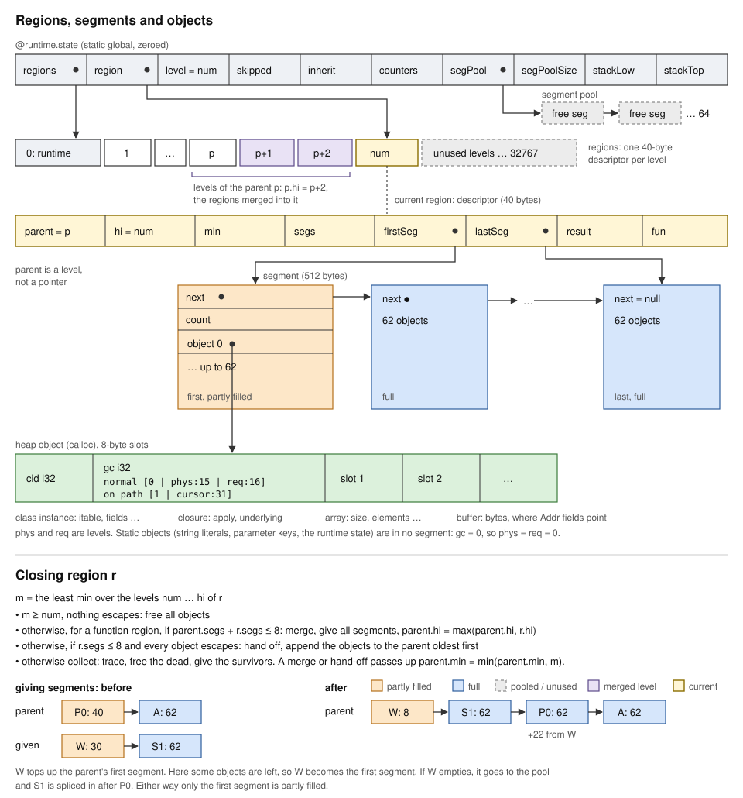

# Memory Management for the LLVM Backend

This document describes how the 64-bit LLVM backend frees memory. The heap
is a stack of regions. A function call or a batch of loop iterations runs in
a region of its own, and closing the region frees what it allocated, except
what escapes it. The design is single-threaded, like the rest of the native
runtime.

Regions are an optimization of peak memory, the resident set size (RSS). A
program without regions is correct and frees nothing before it exits.
Regions never change what a program computes, only how much memory and time
it takes.

The rules for memory must be simple and predictable, so that programmers and
LLMs can shape code to them. Heuristics may change how long a program takes,
never which memory it keeps. The [memory guide](../../docs/usage/guides/memory.md)
states the rules for users and is the contract. This document must agree with
it.

The code:

| File | Content |
|---|---|
| `runtime/native/libc/Regions.jo` | the regions, the barrier, closing, the statistics |
| `runtime/native/libc/Platform.jo` | the runtime state, shared boxes, `JO_MEMSTATS` and `JO_LOOP_STRESS` |
| `CodeGen.scala` | region boundaries, the barrier, placement, iteration regions |
| `Allocations.scala` | which functions and loops may allocate |
| `ResultRegions.scala` | the analysis of what makes up a function's result |
| `IterationRegions.scala` | which loops open regions and the home of each variable |
| `Layout.scala`, `Boxing.scala` | the ranges of shared boxes and the boxing calls |

## The rules for programmers

1. A call frees what it allocated when it returns. It keeps what it returns
   or stores into an older object. If something escapes, the call's region
   may merge into the caller's instead, up to the merge budget of about 500
   objects, and is freed with it.
2. A loop frees what its iterations allocated, a bounded amount at a time.
   Each run of the loop works in batches of 8 KB. A batch ends at the end of
   the first iteration that brings the bytes it requested to 8 KB. The end
   of every batch but the first frees what the batch allocated, except what
   it assigned to a variable declared outside the loop or stored into an
   older object. What the first batch of a run allocated stays in the region
   around the loop until that region closes.

A value a function may return is allocated where the result goes. This is
decided for the whole function, not for each path: a value returned on some
paths goes to the caller on every call.

Accepted limitations:

- A value replaced in a variable declared outside a loop, or in an older
  object, stays until the region of the variable or the object closes,
  usually when its function returns. In a function that never returns, such
  values are never freed.
- There is no explicit collection call and no automatic collection of a
  long-running region.

## Overview

Every object records two region levels. Levels number the open regions from
the oldest, like depths (see [Levels](#levels)):

- `phys`: the region whose storage holds the object.
- `req`: the oldest region the object must outlive.

A heap store `b.f = c` lowers `c.req` to `b.req` if needed. A region that
closes frees all its objects if nothing escapes. Otherwise it merges into its
parent while a budget allows, hands every object to the parent if all of them
escape, or collects: the objects whose `req` is older than the region are
escape roots, their requirement spreads to the objects of the region they
reach, and the region frees every object still required only by itself.

Safety does not depend on scanning the stack. A variable only holds pointers
into the region its home runs in or an ancestor, and a value in a register
only points into the region that was current when it was computed or an
ancestor. A region outlives every frame that can see it.

## Object header

Slot 0 of every heap object is `cid: i32 | gc: i32`. The `gc` half has two
forms:

```
normal    [0 | phys: 15 | req: 16]
on path   [1 | cursor: 31]
```

The on-path form exists only during a trace (see
[Collecting](#collecting)). Levels are limited to 32767 by the `phys` field.
Active regions form a chain, so the lowest common ancestor of two active
regions is the older one, and the barrier compares levels. A region
descriptor is never needed per object.

## Static data

String literals, shared boxes, interface tables and other globals are not
heap objects. They carry a header with `gc = 0`, so `phys = 0` and `req = 0`.
The barrier never lowers them and the trace never enters them.

A string literal is a static `Raw` object whose `content` points into a
static buffer object. Its `capacity` is 0, so nothing writes to the buffer.
Context parameter keys point into static buffers too. Program arguments are
copied into heap buffers at startup. Memory handed to the C library, such as
the alternate signal stack, comes from `calloc`.

## Shared boxes

A primitive value is boxed when it flows into `Any`, for example into a
generic container. Codegen emits the boxes of small values as static data,
one constant array per box class:

- `Int` in [-128, 1024)
- `Char` in [0, 256)
- every `Byte`
- `false` and `true`

`Layout.scala` defines the ranges. The `Boxing` phase calls `boxInt`,
`boxChar`, `boxByte` and `boxBool` of `Platform.jo`. For a value in range
they return the address of its box in the array, and otherwise allocate a new
box. `Long` and `Float` are always boxed anew. The 32-bit backends do not
share boxes. Only the arrays of reachable box functions are emitted. They
take about 60 KB of the executable, mostly the `Int` array. The arrays are in
read-only memory, so a stray write to a header faults.

Sharing is invisible to programs. A box is immutable, and Jo has no
reference equality and no identity hash. Equality, hashing, ordering and
printing go through the unboxed value. The runtime compares addresses with
`sameRef` for context parameter keys, region segments and a shortcut of
string equality, never for boxes.

When they were added, shared boxes halved the peak RSS of the jtk projects
or better and made them faster:

| Project | Time before → after | Peak RSS before → after |
|---|---|---|
| html5 smoke | 2.6–2.8 → 1.9–2.2 s | 186 → 93 MB |
| deflate bench | 0.60–0.73 → 0.25–0.28 s | 60 → 34 MB |
| sat smoke | 0.22–0.25 → 0.06–0.07 s | 30 → 7 MB |

## Allocation

`GC.alloc`, which the backend links to `Regions.alloc`, allocates the object
with `calloc`, writes `phys` and `req` as the current level, and appends the
object to the current region. It also adds the size to `requested`, the
bytes requested since startup, which ends the batches of loop iterations.
`allocResult` and `allocAt` allocate the same way in an older open region
(see [Placing results](#placing-results)).

A region stores its objects in a linked list of segments. A segment is 512
bytes: a `next` pointer, a count and 62 object pointers. Allocation fills the
first segment and puts a new one in front when it is full, so only the first
segment of a region is ever partly filled. A region gets its first segment
on its first object. Released segments go to a pool of at most 64.

Every heap allocation is an object with a header. A byte buffer, for example
of `StringOps.bytes`, `floatToStr` or `cString`, comes from `allocBuffer` and
is an object with the buffer class id. `Bytes` are objects with the bytes
class id. Neither layout has pointers.

A string's `content` field points into its buffer, past the header. Every
`Addr` field is such an interior slot, so an `Addr` stored in a heap object
must point just past the header of a buffer or a static buffer. The trace
checks the class id of the buffer and stops the program if the rule is
broken. Buffers hold no pointers, so the trace lowers them without
descending, and an interior slot is never reversed.

A string with `capacity > 0` has a growable buffer, followed by an `Int`,
`used`, the number of bytes that strings on the buffer hold. An append writes
only past `used`, so no existing string sees the change. The new `Raw` that
shares the buffer is allocated in the current region, and the buffer belongs
to a reachable string, so it is at least as old. The `content` slot needs no
barrier. Runtime functions open no regions and place no results, so this
holds for every append.

## Pointer layout

The trace needs the pointer slots of every object. Codegen emits a table
indexed by class id, `layoutTable`. An entry `[n, s1, ..., sn]` lists the
slots that hold pointers. A slot with `interiorFlag` holds an `Addr`. `n = -1`
marks a reference array, whose elements are all pointers. The `itable` and
`apply` slots point to static data and are not listed.

## Regions

### The region stack

The runtime state, `State` in `Platform.jo`, is a static global. It holds the
descriptor array, the current region and its level, `skipped`, the passed
result level `inherit`, `requested`, the statistics and the segment pool.

The region descriptors form one array indexed by level, allocated at
startup. A descriptor is 40 bytes:

```
{ parent: i32, hi: i32, min: i32, segs: i32, firstSeg, lastSeg, result: i32, fun: i32 }
```

At 32768 levels the array takes 1.25 MB of address space, and only the pages
of the levels in use become resident. `parent` is the level of the parent
region. `hi` is the highest level merged into the region. `min` is the
lowest level an object recorded at this level was promoted to. `result` is
the level the function's result goes to. `fun` numbers the function that
opened the region, for the statistics.



```
@runtime.state (static, zeroed)
┌───────────┬──────────┬───────┬─────────┬─────────┬───────────┬──────────┬───────────┬─────────────┬───┐
│ regions ● │ region ● │ level │ skipped │ inherit │ requested │ counters │ segPool ● │ segPoolSize │ … │
└─────┼─────┴────┼─────┴───────┴─────────┴─────────┴───────────┴──────────┴─────┼─────┴─────────────┴───┘
      │          │                                                              └──► free segment ──► …   (at most 64)
      ▼          ▼
regions: one descriptor per level (40 bytes each)
┌───────────┬───┬───┬───┬─────┬─────┬─────┬──────────────────┐
│ 0 runtime │ 1 │ … │ p │ p+1 │ p+2 │ num │ unused … 32767   │
└───────────┴───┴───┴───┴─────┴─────┴──┼──┴──────────────────┘
                     └─ levels of p ─┘ │   p.hi = p+2: the regions merged into p
                                       ▼
current region descriptor
┌────────────┬─────────┬─────────┬──────────┬────────────┬───────────┬────────────┬─────────┐
│ parent i32 │ hi i32  │ min i32 │ segs i32 │ firstSeg ● │ lastSeg ● │ result i32 │ fun i32 │
└────────────┴─────────┴─────────┴──────────┴─────┼──────┴─────┼─────┴────────────┴─────────┘
                                                  │            └───────────────┐
                                                  ▼                            ▼
                              segment (512 bytes)     segment     segment (last)
                              ┌──────────────┐        ┌────────┐       ┌───────────┐
                              │ next ●       ├───────►│ next ● ├─► … ─►│ null      │
                              │ count        │        │ 62     │       │ 62        │
                              ├──────────────┤        ├────────┤       ├───────────┤
                              │ object 0 ●   │        │ …      │       │ objects   │
                              │ … up to 62   │        │ full   │       │ full      │
                              └──────┼───────┘        └────────┘       └───────────┘
                                     ▼  first, partly filled
heap object (calloc), 8-byte slots
┌─────────┬───────────────────────────────┬────────┬────────┬─────
│ cid i32 │ gc i32                        │ slot 1 │ slot 2 │ …
│         │ normal  [0|phys:15|req:16]    │        │        │
│         │ on path [1|cursor:31]         │        │        │
└─────────┴───────────────────────────────┴────────┴────────┴─────
  class instance: itable, fields…      closure: apply, underlying
  array: size, elements…               buffer: bytes, where Addr fields point
```

### Levels

A merge splices the region's segments into the parent's. The merged objects
keep their `phys` and `req`, since rewriting the headers would cost O(N).
With plain depths, the next child would reuse the merged region's depth and
the barrier would miss an escape:

```
b: merged object, stale req = d+1, really lives until d closes
c: new object in the new child, req = d+1
b.f = c   →  c.req > b.req is false, so c is not lowered
the child closes  →  c is freed, and b.f dangles
```

So each region has a level `num` and the highest level merged into it, `hi`:

```
open:             child.num = parent.hi + 1, child.hi = child.num
merge c into p:   p.hi = max(p.hi, c.hi)
collect, hand-off: survivors get phys = p.num
```

Every object's `phys` and `req` lie in `[owner.num, owner.hi]`, and new
children are numbered above `owner.hi`. No open region has a level in
`(owner.num, owner.hi]`, so a stale level compares like `owner.num` against
every open or future region. If the real owner of `c` is younger than that of
`b`, then `b.req < c.owner.num <= c.req`, and the barrier fires. Between
stale levels of the same owner it may lower `req` without need, which is
safe. All younger regions are closed when `r` closes, so an object is in `r`
exactly when `phys >= r.num`.

Levels grow only when a non-empty region merges, and a close gives back the
region's levels. A frame that calls many small functions whose results it
keeps uses up levels until its region holds 8 segments, after which its
children collect or hand off instead. Deep recursion through such frames can
reach the limit of 32767.

At the limit, `open` stays in the current region and counts the call in
`skipped` and in the statistic `skipped-enters`. The matching `leave` or
`leaveLoop` only undoes the count. All deeper calls share the region at the
limit, which frees nothing until it closes. Merging regions is always safe:
it only delays reclamation.

### The runtime region

Level 0 is the runtime region. It holds what `Core.start` sets up before the
entry function, such as singleton objects, the argument array and the context
entries of `IO.stdout`, `IO.stderr` and `IO.args`, and what code that runs in
no region allocates. The runtime region never closes: the program exits
instead. An object that escapes to level 0 lives until the program exits.

### Region functions

A call to a region function opens a region at entry and closes it before
every `ret`. Which functions open one is set by backend options, not by the
language, since only the native backend can honor regions:

- `--region-policy all`, the default, makes every function a region function,
  except the functions of the runtime (`jo.runtime.*`), the functions that
  cannot allocate, and the functions that only allocate their result (see
  [Functions that only allocate their result](#functions-that-only-allocate-their-result)).
- `--region-policy scalar` makes only the functions that return a primitive
  value other than `Unit` region functions, and `none` none.
- `--region <function>` makes a function a region function under any policy,
  even one that cannot allocate. It can be repeated. It accepts only
  top-level functions outside the runtime. The driver resolves each name to a
  symbol, and a name that matches no top-level function is an error. Class
  methods cannot be named, because `pkg.C.f` could name a method of class `C`
  or a function of section `C`.

A function cannot allocate if it builds no record, calls neither the
allocator nor a function indirectly, and calls no function that may allocate
(`Allocations.scala`, a fixpoint over the call graph). A branch that ends in a
call that never returns, like the failure of an assertion, does not count,
since the program stops there. Without that rule the message of a bounds
check would make every array access open a region.

The entry function is an ordinary function. `jo.main` is a deferred
declaration, and codegen rewires it to the function the frontend picks. The
entry function opens a region like any other, and its loops open iteration
regions. Under `none` or `scalar` it runs in the runtime region unless
`--region` names it.

A region function compiles to:

```
level = enter(id)           // id numbers the function for the statistics
...body...
leave(result)               // null when the result is not a pointer
ret result
```

`enter` returns the level the function runs at, kept in the slot
`%region.level`. Codegen emits the exit sequence before every `ret`. Jo has no
exceptions and `abort` exits the process, so there is no unwinding path.

`leave(result)` lowers `result.req` to the parent's level, like the barrier,
then closes the region if it holds any object, and makes the parent current.
Records and tuples are heap objects, so a result has at most one pointer to
promote.

## Write barrier

Only mutation stores need the barrier:

```
barrier(b, c):
  if c != null and c.req > b.req:
    c.req = b.req
    regions[c.phys].min = min(regions[c.phys].min, b.req)
```

The second line records the promotion for the close of `c`'s region (see
[Knowing that nothing escapes](#knowing-that-nothing-escapes)). It changes
only the stored object. Its children are lowered when a region collects.

Codegen routes every field store through `storeField`, which tells
initialization from mutation. An initialization store needs no barrier: a new
object has `req` at the current level, and anything it can refer to is at
least as old. An object placed in an older region is the exception (see
[Placing results](#placing-results)). The runtime writes array elements with
`writeRef`, which calls the barrier. The 32-bit backends make it a plain
store. Stores into `Addr` fields get no barrier: such a field holds an
interior pointer, which is never mutated.

## Closing a region

| At close | Action |
|---|---|
| Nothing escapes | Free all objects |
| A function region, and the merge budget allows it | Merge into the parent |
| At most 8 segments, and every object escapes | Hand the region to the parent |
| Otherwise | Collect |

An iteration region never merges (see
[Closing an iteration region](#closing-an-iteration-region)).

### Knowing that nothing escapes

Each descriptor records `min`, the lowest level an object of the region was
promoted to. `open` sets `min` to the region's own level. The barrier,
`require` and `leave` record a promotion at the descriptor of the object's
`phys`, with `minInt`, an intrinsic the backend emits as `llvm.smin.i32`.

At the close of `r`, `m` is the minimum of `min` over `[r.num, r.hi]`. After a
merge, a promotion may be recorded at a merged child's level, which no open
region uses, so the scan of the range finds it. Something escapes `r` exactly
when `m < r.num`. A merge and a hand-off pass `m` up:
`parent.min = min(parent.min, m)`.

The barrier records only at the innermost region an object escapes. The
invariant is: if `o.req` is below the `num` of `o`'s owner region, the
minimum over the owner's range is at most `o.req`. Each step that lowers a
`req` or moves an object keeps it:

- The barrier, `require` and `leave` record the new `req` at the owner.
- A merge keeps the child's records in the parent's range and passes `m` up.
- A hand-off passes `m` up, and every handed object is in the parent's range.
- A collect moves a survivor to the parent only if its `req` is at or above
  the parent's `num`, and any other survivor to the region owning its `req`.
- A trace that lowers an object in an ancestor records it at the owner.

### Merging

A merge leaves the work to a later close. It costs the scan of the region's
levels and at most one segment's worth of copied pointers. Merging pays when
something escapes: a survivor is visited at one collecting close, not at
every enclosing close. Merging a region from which nothing escapes would
gain nothing, so such a region frees.

A region merges only if it and its parent have at most 8 segments together,
about 500 objects. This budget bounds the garbage merging holds: a region
holds at most about 500 merged objects of its callees at once.

`give` hands segments to the parent. The partly filled first segment tops up
the parent's first segment. If objects are left in it, it becomes the
parent's first segment. Otherwise it goes back to the pool. The full
segments are spliced in after the parent's first segment, so the parent
again has only one partly filled segment.

```
before a collect

  parent:  first ─► [ P0: 40 ] ─► [ A: 62 ]
  r:       first ─► [ S1: 62 ] ─► [ W: 30 ] ─► [ S3: 0 ]
                     survivors, packed          emptied by the sweep

after

  parent:  first ─► [ W: 8 ] ─► [ S1: 62 ] ─► [ P0: 62 ] ─► [ A: 62 ]
                                               +22 from W
  pool:    [ S3 ] ─► …
```

### The close fast path

A region whose objects all escape holds no garbage, so it is handed over
instead of collected. `close` tries it after a merge is refused, for a
region of at most 8 segments. `allEscape` scans the index and stops at the
first object with `req >= r.num`, so a failed test costs at most one scan,
which a collect does anyway. `handOff` then moves every object to the parent:

```
for every o in r, oldest first:
  o.phys = p.num                   // req stays
  append o to p                    // p.hi stays
p.min = min(p.min, m)
```

The objects join the parent oldest first, as if they had been allocated
there. The segments of `r` go back to the pool as they empty, and the parent
takes them for its new segments. Splicing the segments would skip the copy,
but it breaks the order of allocation (see
[Measurements](#order-of-the-objects-in-a-hand-off)).

It is sound for the reasons a merge is. Every `req` in `r` is below
`r.num = p.hi + 1`, and `p.hi` cannot grow while `r` is open, so every `req`
is in `p`'s range. No object keeps a level of `r`'s range, so the levels are
free for the next region. Objects of `r` that an escaping object reaches are
not lowered with it, but the test requires every object to escape on its own
anyway. A tree whose root alone escapes fails the test and collects.

The bound of 8 segments is needed although the hand-off holds no garbage. A
handed object stays in the parent, so the close of every ancestor scans it
again. In non-tail recursion where every level stores a new object into an
array of the caller, the scans would take time quadratic in the depth. Over
the bound, a region collects and moves each object directly to the region
owning its level.

### Collecting

A collect traces only the objects of the closing region `r`. It runs no user
code, allocates no objects and needs no work list.

```
collect(r):                         // sweep in Regions.jo
  for o in r with o.req < r.num:    // spreadEscapes: the escape roots
    lower(o, o.req)
  for o in r:                       // pack
    if o.req >= r.num: free(o)
    else if o.req >= p.num: o.phys = p.num, keep o at the front of r's segments
    else: q = owner(o.req), o.phys = q, append o to q
  release the empty segments
  give the kept segments to p
```

`owner(l)` walks the parent levels up until it reaches a level at or below
`l`, and caches the last answer. A survivor that goes directly to an older
region is not visited again by the closes in between. Appending to `q` is the
only allocation of a collect: a new index segment when `q`'s first one is
full. It comes from the pool or from `calloc`. A hand-off can also take a
segment before it releases one, when the parent's first segment is full.

The trace stops at the region. When it reaches an object `e` of an ancestor
`Q`, it lowers `e.req`, records it at `Q` and stops. `e` is then an escape
root of `Q`, and its children are traced when `Q` closes. An object `d` of `r`
that `e` already pointed to is covered too: the store into `e` ran the
barrier, so `d` survives `r`.

`lower(root, d)` lowers `req` to `d` for everything in `r` reachable from
`root`, depth first with pointer reversal (Deutsch-Schorr-Waite). The field
that led to the current object holds its parent until the traversal returns.

```
lower(root, d):
  prev = null; cur = root; cur.gc = onPath(0)
  loop:
    i = cur.cursor
    if i < pointerCount(cur):
      c = field(cur, i)
      if c != null and not c.onPath and c.req > d:
        if c.phys >= r.num and pointerCount(c) > 0:
          field(cur, i) = prev            // descend, reversing the edge
          prev = cur; cur = c; cur.gc = onPath(0)
        else:
          c.req = d; record(c.phys, d)    // a leaf, or in an ancestor
          cur.cursor = i + 1
      else:
        cur.cursor = i + 1
    else:
      cur.gc = normal(phys = r.num, req = d)
      if prev == null: return
      j = prev.cursor
      up = field(prev, j); field(prev, j) = cur   // restore the edge
      cur = prev; prev = up; cur.cursor = j + 1
```

An object on the path is in `r` and its `req` is the current `d`, so its whole
`gc` half is free to hold the cursor. The tag bit is checked first. The trace
descends only into an object with `req > d`, so an object is traversed once
per lowering of its `req`, and cycles end at objects on the path. On the way
back it writes `r.num` as `phys`, which compares like the former `phys`.
`lower` returns the objects it lowered, which the statistics add to
`traced`.

### Cost

- A region that allocates nothing costs the calls of `enter` and `leave` and
  a few loads and stores. `leave` skips `close` for an empty region.
- A close from which nothing escapes visits each object once, to free it.
- A merge costs the scan of the region's levels and at most one segment of
  copied pointers.
- A hand-off scans the region twice and copies one pointer per object.
- A collect visits each object twice and traces the objects reachable from
  escape roots.
- A survivor required only by the parent, such as a returned value, moves up
  one region per collect and is traced again at each, since `leave` lowered
  its `req` only to the parent. A returned value that is not placed (see
  [Placing results](#placing-results)) therefore costs work at every
  collecting boundary it passes through. A recursive function that returns
  a structure built in a loop traces it at every level: the `traced`
  statistic and hint report it.

## Placing results

A returned object allocated in the callee's region is promoted at its close,
and again at each close it is returned through. Placing results allocates it
directly in the region the result goes to. It is on under
`--region-policy all`, and `--place-results` turns it on under the other
policies.

Each region records its result level, the level of the open region its
function's result goes to: the caller's level, or a level the caller passed.
A flow-insensitive analysis, `ResultRegions.scala`, marks the values that
must end up in the result region:

- the returned values
- the value assigned to a marked variable
- the fields of a marked record
- the values stored into fields of the object of a marked variable
- the arguments of a marked call that flow into the callee's result

A variable assigned more than once is never marked, nor is a parameter that
is assigned. The analysis cannot tell which of the values is returned, and
marking all of them would keep the overwritten ones. Allocations and calls
inside a loop are never marked, since a loop may allocate many values of
which one is returned.

The marked parameters are the summary of a function for its callers. A
constructor stores its parameters into `this` and returns it, so the summary
covers constructors too. Summaries are computed on demand and cached. A call
back into a function under analysis sees no summary.

Codegen and the runtime:

```
marked record:       allocResult(size)        // at regions[current.result]
                     allocAt(size, l)         // in a function without a region
marked call:         inherit()                // inherit = current.result + 1
                     passResult(l)            // inherit = l + 1, without a region
enter(id):           child.result = inherit > 0 ? inherit - 1 : current.num
                     inherit = 0
resultLevel():       l = inherit > 0 ? inherit - 1 : current.num
                     inherit = 0
```

A placed record is older than the current region, so its initializing
stores go through the barrier, except a function reference like the `apply`
of a closure, which is not a heap object. Past the level limit, the current
function opened no region, so `allocResult` and `inherit` use the current
level instead of the result level.

A direct marked call passes a level only when the callee's result is a
pointer other than `Unit` and the callee takes it, by `takesLevel`: a region
function, which takes it in `enter`, or a function that places without a
region, which takes it in `resultLevel`. A runtime function never takes a
level.

Placement is decided for the whole function, so it can keep memory: a value
returned on some paths only, or stored into such a value, goes to the
caller's region on every call and stays there until that region closes. The
memory guide states this as a rule.

### Functions that only allocate their result

A function whose every allocation goes to its result opens no region. Its
region could only hold what it returns. It calls `resultLevel()` at entry
and allocates its result there. This covers constructors, bridges that box a
value and small factory functions. `placesWithoutRegion` requires all of:

- the policy would make it a region function, and `--region` does not name it
- results are placed, and it returns a pointer other than `Unit`
- every allocation site is placed: each record literal is marked, and so is
  each call that may allocate
- each marked call that may allocate goes to a callee that takes the level,
  or to a callee that itself passes this test

The scan is `allocatesBesides` of `Allocations.scala`, with the placed sites
left out. A runtime callee runs in the current region, which is now the
caller's region. It counts only if it allocates nothing but its result:
`boxInt` passes, since it allocates only the box it returns. `StringOps.+`
and `RefArray.create` fail, since they call the allocator for a buffer, which
can leave temporaries. A function under analysis counts as failing.

So the function allocates nothing that its region would free. The only
differences to a region are where its callees' regions merge, into the
caller's region within the same budget, and where the result of a runtime
callee lands: in the caller's region rather than the caller's result region.
It moves there once, at the caller's close.

Such a function runs in its caller's region, like a function that cannot
allocate. Its level `l` is the caller's level or the caller's result level,
which both outlive the call. It has no loop that allocates, since nothing in
a loop is placed. It gets no number for `--mem-profile`, and its allocations
count for the region they go to.

Under `scalar` and `none` the rule changes nothing: there a function that
returns a pointer opens a region only when `--region` names it.

### Indirect calls

A marked indirect call whose type returns a pointer other than `Unit` always
passes the level. The callee is unknown: if it takes the level, it uses it.
Every other function whose address is taken clears it at entry (see
[The flag](#the-flag)). The type of the call does not tell what the callee
returns: a closure that returns `Unit`, called through a generic `T => S`, is
a call that returns a pointer.

A marked indirect call counts as placed for the rule above when every
function whose address is taken and that returns a pointer would count for a
direct call, or cannot allocate. So a function whose result comes from a
closure or an interface method, like `TaskControlBlock$runTask` of Richards,
opens no region.

#### The flag

`inherit` in the state is 0 except between a call that passes a level and
the entry of its callee. Every function that a call can pass a level to
takes it or clears it first thing:

- a region function takes it in `enter`, also past the level limit
- a function that places without a region takes it in `resultLevel`
- a direct call passes a level only to one of these two
- an indirect call can only reach a function whose address is taken, and such
  a function that is neither of the two calls `clearResult` at entry

So no later `enter` sees a level meant for another call. Clearing after the
call would not be enough: a callee that ignores the flag could call a region
function, which would take the level. Codegen finds the functions whose
address is taken by a scan of all bodies before it emits any: function
references outside the callee position of a call, the entries of the
interface tables it emits, and those of the static classes (strings and
boxes). The clear is emitted only when results are placed.

## Iteration regions

The iterations of one run of a loop share a region, the iteration region.
The iteration covers the condition and the body. At the end of an iteration,
the loop compares `requested` with the value `loopNext` returned when the
batch started, which is 8 KB more. Below it, the next iteration runs in the
same region. At or above it, the region closes and a new one opens. Every
exit of the loop closes it.

The region opens at the first iteration end that reaches the bound, not at
the start of the loop. Until then the iterations run in the region current
before the loop. So the first batch of a run stays in the region around the
loop, and a run that allocates less than 8 KB opens no region at all. Codegen
lowers such a `While` to:

```
              level = Regions.level(); open = false
              next = Regions.loopNext()
while.cond:   c = cond
              br c, while.body, while.exit
while.body:   body
              br Regions.requested() >= next, while.cycle, while.cond
while.cycle:  if open: leaveLoop()
              level = enterLoop(); open = true
              next = Regions.loopNext()
              br while.cond
while.exit:   if open: leaveLoop()
```

`level` is the level the iterations run at, kept in a slot. `enterLoop` opens
a region like `enter`, with the result level and the function id of the
current region, so the statistics see the function. It does not read a
passed result level, which a call sets right before the call. It counts the
region in `iteration-regions`, and past the level limit it skips like
`enter`. `leaveLoop` closes the region without merging.

`requested` counts the bytes of every allocation in the program, including
those of callees that free them. Under `JO_LOOP_STRESS`, set to a value other
than the empty string and `0`, `loopNext` adds nothing, so the region closes
at the end of every iteration. The tests use this to find premature frees.

The cost per iteration is two loads and one compare, plus one compare per
assignment to a variable of an older home. LLVM inlines `level`, `loopNext`,
`requested` and `require`. Only the close of a batch calls the runtime.

### Which loops open regions

A loop opens iteration regions when both hold:

1. Its function opens a region. This keeps the runtime out, whose functions
   never open one. Under `none`, only the loops of functions named with
   `--region` open iteration regions.
2. The condition or the body may allocate, by `mayAllocate(word)` of
   `Allocations.scala`. An indirect call counts as allocating.

A loop that cannot allocate would never reach its bound, so codegen leaves
out even the compare.

### Exits and labeled returns

Every way out of an iteration other than its end is a `Return` in the lowered
tree: `break`, `continue` and the step of a tail-recursive loop are returns
to a label. Codegen records the number of running loops at each `Labeled`
and closes the region of every loop between the `Return` and its target, if
it opened one. A labeled return carries no value: codegen asserts a void
`Labeled`.

- `continue` targets a label around the body, so it leaves nothing and falls
  into the normal end of the iteration.
- `break` targets a label around the `While`, so it closes one region.
- A return from the function first promotes its result to the function's
  level with `require`, then closes the region of every running loop,
  innermost first, then runs `leave(result)`.

`TailCallOpt` turns a self-recursive function into a loop whose step assigns
the next arguments to copies of the parameters, assigned before the loop.
They belong to the function, so the arguments a step replaces stay in the
function's region until it returns, like any value replaced in a variable
declared outside a loop.

### Assignments to variables declared outside the loop

Every variable has a home: the region of the function, or the iteration
region of a loop. A variable belongs to the innermost region-opening loop
whose condition or body contains all of its occurrences and writes it before
it reads it in every iteration. Parameters and all other variables belong to
the function. A variable that fails the check at one loop is checked again at
the next enclosing one. Falling back is sound and only keeps more.

The rule does not use `isDefine`, since many phases emit plain `Assign`s for
the variables they create, such as pattern binders, the variable of
`for x in xs` and the temporaries of `LowerContextParams`, `MaterializeView`
and `Erasure`. Each of them writes its variable before it reads it.

Writing before reading is a soundness condition: a read before the write
would see a value of an earlier iteration, which a close may have freed.
`IterationRegions.scala` checks it with one walk of the condition and the body
in evaluation order, keeping the set of variables written so far, like the
definite assignment of Java:

- A `Bool` word has a set when it is true and one when it is false. A
  literal `true` has all variables when false, since that cannot happen, and
  `false` the reverse.
- `If(c, t, e)` walks `t` with the when-true set of `c` and `e` with the
  when-false set, and meets the results. `a && b` and `a || b`, which the
  frontend types as calls of `Bool_and` and `Bool_or`, are treated as
  `If(a, b, false)` and `If(a, true, b)`, as codegen compiles them.
- A `Return` and a call that never returns have all variables, so a branch
  that cannot complete drops out of the meet.
- A nested `While` and a `Labeled` leave the set at their entry, since their
  body may run zero times or be left early.
- The argument of `paramKey` is a name, not a read.

The sets make pattern binders pass: `case Some(v) => body` writes `v` in the
when-true set of the test. The same holds for `while cur is Some(node)` and
`for k ~ v in m`.

An assignment `v = x` in a loop to a variable that holds a heap reference,
whose home is outside the innermost running loop, promotes `x` to the level
of that home:

```
require(x, l):   if x != null and x.req > l:
                   x.req = l
                   regions[x.phys].min = min(regions[x.phys].min, l)
```

`l` is read from the slot of the home: `%region.level` for the function, or
the level slot of the loop. The barrier is complete because codegen sees
every write to a mutable variable: a lambda or a local function cannot
capture one (`checkCapture` in `Checker.scala`). The one `Assign` that is not
a local write, to the holder of a singleton, occurs only in
`objectInitProc`, which has no loop.

### Nested loops

An inner iteration region is a child of the outer one, or of the region the
outer iterations run in before their region opens. An inner loop closes its
region at every exit, so no inner region is open when an outer iteration
ends. The outer level slot changes only at an outer batch end, so it is the
right level whenever an inner loop runs.

### Closing an iteration region

An iteration region never merges. Its parent stays open for the whole loop,
so merged garbage would stay until the loop ends and rule 2 would not hold.
It frees, hands off or collects like a function region. `leaveLoop` tests the
first two cases inline when the region has one segment and nothing merged
into it, the common case for small batches. A callee region still merges
into the iteration region while the budget allows, and the iteration region
frees or collects that garbage at its own close.

An open iteration region takes one level, and its close gives back that level
and every level merged into it. So a frame needs one more level per nested
loop that runs with an open region.

### Why iteration regions are sound

When iteration region `I` closes:

- No region younger than `I` is open. Every call of the iteration returned,
  and every inner loop closed its region at its exit.
- No other frame runs in `I`. Older frames hold no pointer into `I`.
- The variables whose home is `I` are dead at every iteration end: every
  iteration writes them before it reads them. So `I` holds the objects of
  several iterations, but only the last one can reach them, and only through
  other variables, stores or the result.
- Every other variable has an older home, so what it refers to was promoted
  by `require` and is an escape root of `I`.
- A register holds a value computed before the loop, in an older region, or
  one computed in the same iteration. A value leaves an iteration only
  through a variable, a heap store or the function's result, which is
  promoted before the leaves. A `While` and a `Labeled` have no value.
- Objects of older regions reach `I` only through stores, whose barrier made
  escape roots.

So the escape roots of `I` are complete. Before the region opens, the
iterations run in the region current at the start of the loop, which
outlives the loop and is sound like any code that runs in it.

## Memory statistics

The runtime always counts allocations, frees, promotions to the runtime
region and the outcomes of closes. With the environment variable
`JO_MEMSTATS` set to a value other than the empty string and `0`, a program
prints them on stderr when it exits normally or by `abort`. It does not print
them when it runs out of memory or overflows the stack, because printing
allocates.

```
jo-mem summary peak-rss-kb=1792 allocated=1000017 freed=1000004 runtime-region=13 skipped-enters=0
jo-mem to-runtime direct=13 store=0 trace=0 return=0
jo-mem closes free=3908 handoff=0 merge=0 collect=0 traced=0
jo-mem loops iteration-regions=3906
jo-mem hint rebuild with --mem-profile to attribute these to functions
```

- `summary`: the peak RSS in KB, the objects allocated and freed, the objects
  in the runtime region at exit, and the enters skipped at the level limit.
  After an `abort`, the objects of the open regions are neither freed nor in
  the runtime region.
- `to-runtime`: the objects allocated directly in the runtime region
  (`direct`), and those promoted to it by a store or an assignment, by the
  trace of a closing region, and by a return to code in the runtime region.
  Under the default policy, `direct` and `return` stay near 0.
- `closes`: the closes that freed everything, handed off, merged and
  collected, and `traced`, the objects the traces of collects lowered,
  besides the escape roots. An object traced at every close it passes through
  counts once per close, so `traced` far above `allocated` means repeated
  tracing.
- `loops`: the iteration regions opened, not counting enters skipped at the
  level limit.

Built with `--mem-profile`, the backend emits the names of the region
functions and classes, and the report names the functions responsible. Each
region function gets 12 `i32` counters, allocated at startup only when
`JO_MEMSTATS` is set: `store`, `trace`, `peakSegs`, `peakCaller`, `into`,
`caller`, `storeBase`, `traceBase`, `return`, `returnBase`, `traced` and
`tracedCaller`. `Regions.jo` names the offsets. `enter` stores the number of
the function in the descriptor, so a store is charged to the function of the
current region, a trace to the function of the closing region, and a return
to the runtime region to the function whose region closes. Function 0 is
`runtime`.

```
jo-mem promoted kind=store count=1000000 fun=server.handle at=server.jo:9 into=server.Stats caller=runtime
jo-mem region objects=1000060 fun=server.main at=server.jo:12 caller=runtime
jo-mem traced objects=35411000 fun=jo.Array.tabulate at=lib/Array.jo:150 caller=trees.build
```

- `promoted kind=store|trace|return`: the objects the function promoted to
  the runtime region by stores, by the trace of its region, and by returning
  to code in the runtime region. `into` is the class stored into last.
  Promotions by assignment count only in the total.
- `region`: the most objects the function's region held at once, measured in
  segments of 62, so it overestimates by up to 61.
- `traced`: the function's share of `traced`, saturating at 2^31 - 1.

`caller` is the nearest function of an enclosing region whose name does not
start with `jo.`, so it names user code. Each kind has up to 10 rows, the
largest first, and leaves out rows under 1000 objects.

Hints follow the rows, printed by the runtime when a row of their kind is:
`store`, `trace`, `region`, `library` (a row names a `jo.*` function),
`runtime` (when `direct` or `return` is at least 1000, also without names)
and `traced` (when `traced` is more than 4 times `allocated`, also without
names). The memory guide lists them with their fixes.

### Growth reports

A program that never exits never prints the report. With `JO_MEMSTATS` set,
the runtime also reports while a region grows. When the runtime region
reaches 1024 segments, about 63000 objects, and each time it doubles after
that, it prints a `growth` line, followed under `--mem-profile` by
`growth-promoted` rows that count since the previous report:

```
jo-mem growth runtime-region=126915 peak-rss-kb=8576 direct=0 store=63488 trace=0 return=0
jo-mem growth-promoted kind=store count=63488 fun=server.handle at=server.jo:9 into=server.Stats caller=runtime
```

When any other region reaches 1024 segments, and each time this shared
threshold doubles, the runtime prints a `growth-region` line for the largest
open region:

```
jo-mem growth-region objects=63490 peak-rss-kb=5120 fun=server.main at=server.jo:12 caller=runtime
```

The first report with a row adds its hint. Without names, the first report
suggests rebuilding instead. `grew` notes that a report is due when a region
gains a segment. The report is printed at the next `leave` or `leaveLoop`,
once the state is consistent. It runs in a region of its own, so it adds
nothing to the promotions, and it restores `requested`, so iteration regions
close at the same iterations with and without `JO_MEMSTATS`.

## Options and policies

```
jo compile --llvm app.jo -o app
jo compile --llvm --region-policy none --region app.process app.jo -o app
jo compile --llvm --mem-profile app.jo -o app && JO_MEMSTATS=1 ./app
```

| Option | Effect |
|---|---|
| `--region-policy all\|scalar\|none` | which functions open a region besides `--region`, see [Region functions](#region-functions). Default `all`. |
| `--region <function>` | a top-level function that opens a region under any policy. Repeatable. |
| `--place-results` | place results under `scalar` and `none`. Always on under `all`. |
| `--mem-profile` | name the functions and classes in the statistics |
| `JO_MEMSTATS=1` | print the statistics and growth reports |
| `JO_LOOP_STRESS=1` | close iteration regions at every iteration end, for tests |

### Choosing the policy

The default policy `all` gives the lowest peak RSS. It costs time in small
functions that are called very often and may allocate, since they pay for
`enter` and `leave` on every call, even when they allocate only on a path
that never runs.

`--region-policy none` with a `--region` for a few functions trades some of
that time back. The steps to pick the functions are in the
[memory guide](../../docs/usage/guides/memory.md#trading-time-back). On the
jtk deflate bench, `deflate 6 1024`, one region function kept the peak RSS of
`all` at nearly the time of `none`. These numbers were taken before shared
boxes and iteration regions:

| Build | Time | Peak RSS |
|---|---|---|
| `all` | 1.02 s | 136 MB |
| `none` | 0.77 s | 163 MB |
| `--region-policy none --region Bench.words` | 0.82 s | 135.5 MB |

There is no `--no-region`. Removing a single region from `all` would merge
its allocations into the caller's region, so it would not lower RSS.

## Interaction with the optimizer

- `enter`, `leave`, `enterLoop` and `leaveLoop` are `noinline`, so LLVM sees
  opaque calls that may write memory, and no load moves across them.
  Inlining a region function keeps its calls of `enter` and `leave`.
- The barrier and `require` are inlined. Removing a dead heap store leaves
  the promotion in place, which is conservative.
- Allocations are never removed, because every object escapes into its
  region's segment.

## Limitations

- Under `--region-policy none` without `--region`, a program frees nothing
  before it exits.
- Objects promoted to the runtime region stay until the program exits.
- A value stored into an older object, or assigned to a variable declared
  outside a loop, stays after it is replaced until the region of the object
  or variable closes. In a function that never returns, it is never freed.
- The first batch of each run of a loop stays in the region around the loop.
- A returned value that placement misses, for example one built in a loop or
  in a variable assigned twice, is traced again at every enclosing close that
  collects.
- A merge holds the garbage of the merged region until a later close, up to
  the budget of 8 segments per region.
- Past the level limit, calls and loops share the region at the limit, which
  frees nothing until it closes.
- A growth report waits for the next `leave` or `leaveLoop`. A region that
  reached the threshold and closed before then is not reported.
- `calloc` and `free` per object are slower than a bump allocator.
- The statistics charge a promotion to the innermost region function and
  count objects, not bytes. Telling library functions apart by the `jo.`
  prefix is a heuristic.

## Measurements

Times are the median user time of 5 or 9 interleaved runs, pinned to one core
of an x86-64 machine, against the commit before the change. The allocator
alone can move a benchmark by 15%, since the order in which `calloc` and
`free` reuse memory changes with the layout of the heap, so single runs
decide nothing.

### Batch size

The first implementation opened a region per iteration. It cost Permute 25%,
a tight loop with one dead object per iteration 22%, `l = Cons(i, l)` 32% and
`s = s + "ab"` 45%. Permute's loops allocate nothing but call region
functions, so each of its 8.66 million iterations paid an open and a close of
an empty region. Batching pays these costs once per 8 KB:

| Program | Before | 4 KB | 8 KB | 16 KB | 32 KB | 64 KB |
|---|---|---|---|---|---|---|
| Tight loop | 0.45 s | 0.40 s | 0.45 s | 0.41 s | 0.42 s | 0.45 s |
| `l = Cons(i, l)` | 0.43 s | 0.46 s | 0.47 s | 0.50 s | 0.54 s | 0.49 s |
| `s = s + "ab"` | 0.11 s | 0.12 s | 0.12 s | 0.13 s | 0.17 s | 0.16 s |

8 segments hold 496 objects, 15.9 KB of 32-byte objects, so with a bound up
to 8 KB a batch of small objects that all escape is handed off. Above 16 KB,
the closes of the append and cons loops collect, which costs more per object.
Below 8 KB, times do not improve and closes get more frequent. 8 KB is the
largest bound with hand-offs.

### Opening the region at the first close

Opening the iteration region when the run starts would free the first batch
too, and rule 2 would have no exception. Measured with `enterLoop` before the
condition and an unconditional `leaveLoop` at each close and exit, median of
9 runs:

| Program | Open at the first close | Open at the start |
|---|---|---|
| Permute | 0.48 s | 0.52 s (+8%) |
| Storage | 1.61 s | 1.70 s (+6%) |
| Havlak | 2.09 s | 2.64 s (+26%) |
| Json, Sieve, Richards, DeltaBlue | 1.28, 1.24, 1.03, 0.28 s | the same |

A second run gave Permute +9%, Storage +0% and Havlak +20%. Permute runs its
loops 3.6 million times, each a few iterations long, and Havlak runs many
short loops. Each run would pay an open and a close of an empty region. The
first batch is at most 8 KB plus one iteration, so the lazy open stays.

### Merge before the fast path

The fast path is tried after a merge. Trying it first would save the level a
merge uses, but turns merges into scans:

| Program | Before the fast path | Merge first | Fast path first |
|---|---|---|---|
| Permute | 0.49 s | 0.51 s | 0.48 s |
| Havlak | 2.79 s | 2.63 s | 2.61 s |
| Json | 1.27 s | 1.29 s | 1.48 s |

Json is about 4% slower with the fast path first in every run, since 157501
of its merges become a scan and a rewrite. Both orders remove all but one
collect of Permute and Towers, 37% of those of DeltaBlue and 20% of those of
Havlak. Peak RSS and `traced` do not change. Without the bound of 8
segments, deep recursion that stores a box per level into an array of `main`
took 6.0 s for 5 rounds of depth 20000, against 0.09 s with it.

### Order of the objects in a hand-off

A hand-off first spliced the segments of `r` into the parent like a merge,
which breaks the order of allocation. The C library reuses freed memory last
in, first out, and a region frees its objects in the order of its segments,
so the order of a region becomes the order of addresses in the next round.
In 40 rounds of `build(100000)`, which conses 100000 nodes in a loop and
returns the list, the share of list links that jump more than 64 bytes grew
from 2% to 28% with splicing. Appending oldest first keeps it at 2% to 3%.
The 40 rounds took 0.60 s before the fast path, 0.69 s spliced and 0.64 s
appended.

### Passing the result level through indirect calls

Without it, `TaskControlBlock$runTask` of Richards opens a region again, and
Richards takes 1.33 s instead of 1.05 s. It changes only where a returned
value is first allocated, never which memory is kept, so it needs no rule in
the memory guide.

### The rule for functions that only allocate their result

Three candidates were measured against the wider rule of bd11eeb2 (see
[History](#history)): dropping the rule, a strict narrowing in which a call of
a runtime function never counts, and the narrowing kept. Median of 9 runs.
The strict and the kept narrowing ran in separate sessions, each with its own
base. Peak RSS changed only for `walk`.

| Program | Base 1 | Dropped | Strict | Base 2 | Kept |
|---|---|---|---|---|---|
| `walk`, depth 17 | 73.0 MB | 17.7 MB | 17.7 MB | 73.0 MB | 17.7 MB |
| Sieve | 1.28 s | 1.79 s | 1.74 s | 1.27 s | 1.28 s |
| Richards | 1.07 s | 1.32 s | 1.06 s | 1.07 s | 1.04 s |
| Havlak | 2.13 s | 2.41 s | 2.26 s | 2.22 s | 2.21 s |
| DeltaBlue | 0.24 s | 0.27 s | 0.26 s | 0.23 s | 0.24 s |
| Tree, 4 constructor arguments | 0.24 s | 0.34 s | 0.24 s | 0.24 s | 0.24 s |

Dropping the rule costs Sieve 40% and Richards 23%: Sieve's bridge of
`Iterator[Int].next`, Richards' `runTask` and every constructor open a region
again. The strict narrowing costs Sieve 36%, since the bridge calls the
runtime function `boxInt`. The kept narrowing costs nothing measurable and
fixes `walk`.

### Trees built in a loop

Nothing in a loop is placed, so a tree built through `Array.tabulate` or
`List.map` is traced and moved again at each level. Against the placement of
stored values that bd11eeb2 removed, Storage takes 5.8 s instead of 1.48 s and
traces 88.4 million objects instead of none. A tree of depth 8 built 200
times through `tabulate` takes 2.1 s instead of 0.60 s. Richards, Json,
Havlak, DeltaBlue and Permute do not change beyond noise. The memory guide
shows how to restructure such a tree: pass a fixed number of children to the
constructor, or build with `--region-policy none` and a `--region` for the
caller.

## Tests

- `tests/gc` compares the output of programs whose objects must survive:
  escapes through results, stores and closures (`escapes.jo`,
  `closure-escape.jo`), segments (`lazy-segments.jo`), shared boxes, the
  close fast path (`close-*.jo`), iteration regions (`loop-*.jo`) and
  placement (`place-*.jo`). A test can name options in a first line
  `// options: ...`. `ci` runs them on the LLVM backend.
- `tests/custom/gc-regions` checks that memory is reclaimed, under limits of
  address space: the policies and `--region`, a large buffer per iteration,
  the entry function, the flag for indirect calls, hand-off counts and
  iteration region counts.
- `tests/custom/gc-memstats` checks the statistics, rows, hints and growth
  reports, and bounds on the peak RSS of loops that store into the result
  (`pick.jo`, `overwrite.jo`) and of `walk.jo`.
- `tests/custom/gc-region-merge` and `gc-region-survivors` bound the peak RSS
  of merging and of handing many survivors to a parent.

Run `tests/gc` also under `JO_LOOP_STRESS=1` and with AddressSanitizer. To
check for memory errors, keep the IR with `--keep-ll`, add `sanitize_address`
to the attribute groups and compile it with `clang -fsanitize=address`. With
clang 15 on recent kernels, AddressSanitizer itself needs `setarch -R`.
Without `require` on assignments to variables declared outside a loop, ASan
reports heap-use-after-free in 16 of the 27 tests of the time.

## Later: a faster allocator

A faster scheme gives each region its own large chunks and bump-allocates
objects in them. A chunk can only be freed when none of its objects survived,
since a survivor keeps its address. The allocator must then count the live
objects of each chunk. This changes only the allocator, not the region
design.

## History

The design started from explicit function regions with deferred promotion,
and changed to regions chosen by the backend, traces that stop at the closing
region, survivors moved by handing over segments, and merging within a
budget. Two later mechanisms were removed, and a third narrowed, because
they made which memory a program keeps depend on rules programmers cannot
see:

- **Automatic loop collection** (5059db4e, removed in 53e86dcf). It collected
  the function's region at the end of a loop iteration once the bytes
  requested reached a threshold, marking from the live variables of the
  frame. Which garbage a loop held depended on a counter and a liveness
  analysis, and it needed frame roots, an operand rewrite, a mark bit, a size
  table, `JO_LOOP_COLLECT` and `--no-loop-collect`. Iteration regions
  (dae7deae) replaced it.
- **Placement of values stored in loops** (1d36c443, refined in 48530586
  and 006dcac9, removed in bd11eeb2). It placed a value that a loop
  stored into the result, like `arr[i] = f(i)` in `Array.tabulate`, in the
  result region. An overwritten slot kept its old value there until the
  region closed: a loop that overwrites the one slot of the array it returns
  a million times, 5 times over, kept 79 MB instead of 40 MB. Whether a store
  counted depended on the shape of wrapper functions.
- **The wider no-region rule** (1d36c443, narrowed in 7985642c). A function
  opened no region when every allocation site was marked, whatever the
  callee. A runtime callee then left its temporaries in the caller's region:
  `walk`, which builds `"(" + walk(l) + "," + walk(r) + ")"`, kept 73 MB
  instead of 17.7 MB.

Known gap: a function that only boxes primitives, like the `swap` of
Permute, opens a region although its boxes are always shared. Under `scalar`
Permute takes 0.23 s against 0.46 s.
