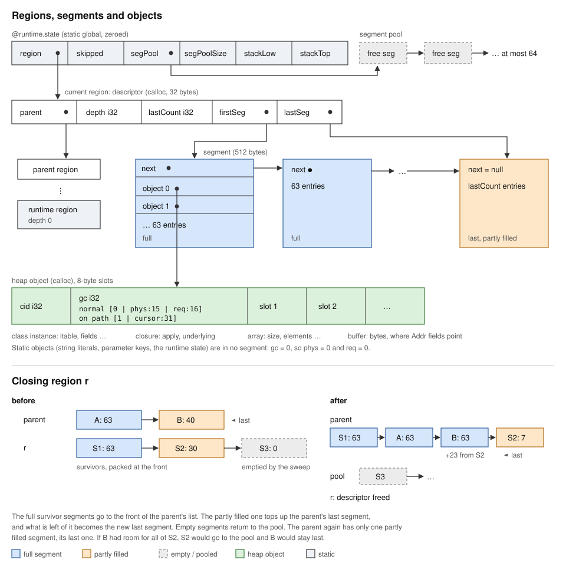

# Memory Management for the LLVM Backend

This document designs memory reclamation for the 64-bit LLVM backend. It
builds on an earlier design, explicit function regions with deferred
promotion, and changes it in four places:

1. Region functions are chosen by the user in backend configuration, not by a
   language annotation.
2. Cleanup traces only the objects of the closing region.
3. Cleanup allocates nothing. The trace reverses pointers instead of keeping a
   work list.
4. Survivors move to the parent region by handing over storage segments.

The design is single-threaded, like the rest of the native runtime.

## Overview

The heap is a stack of regions. A call to a region function opens a child
region and closes it on return. All allocations go into the current region.

Every object records two region depths:

- `phys`: the region whose storage holds the object.
- `req`: the shallowest region the object must outlive. Always `req <= phys`.

A heap store `b.f = c` lowers `c.req` to `b.req` if needed. When a region
closes, objects whose `req` is shallower than the region are escape roots.
Their requirement spreads to the region's objects they reach. Then the region
frees every object still required only by itself and hands the survivors to
its parent.

Safety does not depend on scanning the stack. A frame only ever holds
pointers into its own region or an ancestor region, and a region outlives
every frame that can see it.

## Region boundaries

`@region` cannot be part of the language because only the native backend can
honor it. Region functions are backend configuration instead:

- `--region <function>` makes a function a region function. The flag can be
  repeated. Listing region functions in `jo.toml`, like `--link` mappings, is
  not implemented yet.

The backend does not choose region functions itself. Users who want to reduce
memory use pick them. Choosing them automatically is a separate concern that
can be improved later without changing this design.

### The runtime region

The runtime marks one region explicitly, the same way. Depth 0 is the runtime
region. It holds what the runtime sets up before the program starts: singleton
objects, program arguments and the standard streams. The entry `start` opens
region 1 before it calls the user's `main` and closes it after.

An object that escapes to depth 0 is held by runtime state, so it must live
until the program exits.

### Tail-recursive functions

Jo's tail-call optimization turns a self-recursive function into a loop. A
region function rewritten this way is out of scope for now. Later the compiler
can warn that the region marking is ignored for such a function.

Merging regions is always safe. It only delays reclamation. The backend
therefore may ignore a region boundary when it is inconvenient, for example
beyond the depth limit.

## Object header

Slot 0 of every heap object is `cid: i32 | gc: i32`. The `gc` half has two
forms:

```
normal    [0 | phys: 15 | req: 16]
on path   [1 | cursor: 31]
```

The on-path form is used only during cleanup (see below).

Depth 0 is the runtime region. Region depth is limited to 32767 by the `phys`
field. A region function called at the limit runs in the current region
instead of opening a new one.

Since active regions form a chain, the lowest common ancestor of two active
regions is the shallower one. The barrier therefore compares depths. A region
descriptor is never needed per object.

## Static data

String literals, interface tables and other globals are not heap objects. They
carry a header with `phys = 0` and `req = 0`, so the barrier never lowers them
and the trace never enters them.

A string literal is a static `Raw` object whose `content` points into a static
buffer object. Context parameter keys point into static buffers too. Program
arguments are copied into heap buffers at startup, and memory handed to the C
library, such as the alternate signal stack, comes from `calloc`.

## Allocation

`GC.alloc` stays the single allocation entry point. It allocates the object
with `malloc`, writes `phys` and `req` as the current depth, and appends the
object to the current region.

A region stores its objects in a linked list of fixed-size segments. Each
segment is an array of object pointers. Allocation adds a segment when the
last one is full. This is the only place the region storage grows.

Only the last segment of a region is ever partly filled. The segment size is
therefore not a tuning knob: the index costs one word per object, plus at most
one partly filled segment per open region. A small segment keeps that waste
low for deep recursion through region functions.

Every heap allocation must be an object with a header. Today the runtime also
allocates raw byte buffers, for example in `StringOps.bytes`, `floatToStr` and
`RawBytes`. These become objects with a "no pointers" layout.

A string's `content` field points into its buffer, past the header. The layout
table marks such a slot as interior with a fixed offset, and the trace
subtracts the offset to find the object. Every `Addr` field is such a slot,
so an `Addr` stored in a heap object must point into a buffer or a static
buffer, never into C memory or past the start of the content. The trace checks
the class id of the buffer and stops the program if the rule is broken.
Buffers hold no pointers, so the trace lowers them without descending, and an
interior slot is never reversed.

`malloc` keeps object addresses stable and frees objects one at a time. A
size-class allocator can replace it later without changing the design.

## Pointer layout

The trace needs the pointer slots of every object. Codegen knows every class,
closure, array and box layout and emits a table indexed by class id. An entry
describes one of:

- fixed slots: a list of slot indices that hold pointers.
- reference array: every element is a pointer.
- no pointers: `Bytes`, boxed numbers, raw buffers.

The `itable` and `apply` slots point to static data and are not listed.

## Write barrier

Only mutation stores need the barrier:

```
store(b, slot, c):
  if c != null and c.req > b.req:
    c.req = b.req
  slot = c
```

Initialization stores need no barrier. A new object `b` has `req` equal to the
current depth, and any `c` it can refer to already has `c.req` at that depth or
shallower.

Codegen already routes every field store through one helper, `storeField`,
which tells initialization from mutation. The barrier goes there.

Stores performed by the runtime also need the barrier:

- `RefArray.set` writes array elements with `writeAddr`. It gets a
  barrier-aware primitive `writeRef`, which the 32-bit backends rewrite to a
  plain store.
The barrier changes only the stored object. Propagation to its children is
deferred to cleanup.

Stores into `Addr` fields get no barrier. Such a field holds memory outside
the regions, like the runtime state, or an interior pointer, which is never
mutated.

## Region entry and exit

A region function compiles to:

```
enter()                     // push a region at depth + 1
result = body
if result is a pointer:
  require(result, depth - 1)    // result.req = min(result.req, depth - 1)
close()
return result
```

Codegen emits the exit sequence before every `ret` of the function, including
labeled returns. Jo has no exceptions and `abort` exits the process, so there
is no unwinding path.

Records and tuples are heap objects, so a result has at most one pointer to
promote.

## Cleanup

Cleanup runs no user code, allocates nothing and traces only the objects of
the closing region `r`.

### Why tracing stops at the region

The gist's algorithm follows pointers into ancestor regions. That is not
needed. When the trace reaches an object `e` in an ancestor region `Q`, it
lowers `e.req` and stops. Then `e.req < depth(Q)`, so `e` is an escape root of
`Q`, and its children are traced when `Q` closes. Until then they stay in a
live region and are safe.

An object `d` of `r` that `e` points to is covered too. The store into `e` ran
the barrier, so `d` survives `r` and moves up with the survivors. When `Q`
closes, the trace from `e` reaches `d` and lowers it further.

### Algorithm

```
close(r):
  for o in r.objects:
    if o.req < depth(r):          // escape root
      lower(o, o.req)

  for o in r.objects:             // sweep
    if o.req == depth(r):
      free(o)                     // never dereferences other objects
    else:
      o.phys = depth(r) - 1
      keep o                      // pack survivors at the front
  release the empty segments
  move the full segments to the front of r.parent's list
  top up r.parent's last segment from the partly filled one
  current region = r.parent
```

`lower(root, d)` lowers `req` to `d` for everything in `r` reachable from
`root`. It is a depth-first traversal with pointer reversal
(Deutsch-Schorr-Waite). When the traversal descends into a child, the field
that pointed to the child holds the parent instead. The chain of reversed
fields is the traversal stack, and each field is restored on the way back.

```
lower(root, d):
  prev = null
  cur = root
  cur.gc = onPath(cursor = 0)
  loop:
    i = cur.cursor
    if i < pointerCount(cur):
      c = field(cur, i)
      if c != null and not c.onPath and c.phys == depth(r) and c.req > d
          and pointerCount(c) > 0:
        field(cur, i) = prev      // reverse the edge
        prev = cur
        cur = c
        cur.gc = onPath(cursor = 0)
      else:
        if c != null and not c.onPath and c.req > d:
          c.req = d               // in an ancestor or a leaf: lower only
        cur.cursor = i + 1
    else:
      cur.gc = normal(phys = depth(r), req = d)
      if prev == null: return
      j = prev.cursor
      up = field(prev, j)         // restore the reversed edge
      field(prev, j) = cur
      cur = prev
      prev = up
      cur.cursor = j + 1
```

An object on the path is always in `r`, and its `req` is the current `d`. Both
are implied, so its whole `gc` half is free to hold the cursor. A 31-bit
cursor covers any array. The tag bit is checked first, because the depths of
an object on the path are not stored.

The traversal descends only into an object with `req > d`. That condition also
replaces the gist's `processed` map: an object already lowered to `d` or
shallower has nothing left to propagate. Cycles end at objects on the path.

### Cost

- Space: none beyond the objects themselves.
- Time: an object of `r` is traversed once per lowering of its `req` within one
  close. `req` only decreases, so this is bounded by the region depth, and it is
  once in the common case. Objects outside `r` are never traversed.
- A survivor moves up one region per close. At each later close it is an escape
  root again, but its children are already lowered, so its trace costs one
  pass over its fields.

## Interaction with the optimizer

The design holds under LLVM's optimizations:

- Inlining a region function keeps `enter` and `close`, which are explicit
  calls. Losing a boundary would only merge regions, which is safe.
- The barrier is inlined code with a store. Removing a dead heap store leaves
  the barrier's promotion in place, which is conservative.
- No load can move across `close`, because LLVM sees an opaque call that may
  write memory.
- Allocations are never removed, because every object escapes into its region's
  segment.

`enter`, `close` and `lower` are marked `noinline` to keep the boundary opaque.
The barrier may be inlined.

## Limitations

- Programs without configured region functions free nothing before `main`
  returns. This is the current behavior.
- Objects promoted to the runtime region stay until the program exits.
- Garbage accumulates inside a long-running region, for example in a loop.
- A removed escape stays promoted until its destination closes, as in the gist.
- `malloc` per object is slower than the current bump allocator.

## Later: a faster allocator

Allocating each object with `malloc` and freeing it with `free` is simple and
correct, but slower than the bump allocator the backend uses today.

A faster scheme gives each region its own large chunks and bump-allocates
objects in them. Freeing a whole chunk at once is cheap, but a chunk can only be
freed when none of its objects survived. A survivor keeps its address, so it
stays in the chunk of the closed region. The allocator must then count the
live objects of each chunk and free the chunk only when the count reaches zero.

This changes only the allocator, not the region design.

## Implementation

The runtime is `runtime/native/libc/Regions.jo`. A region descriptor and its
segments come from `calloc`. A segment is 512 bytes: a `next` pointer and 63 objects.
Only the last segment of a region is partly filled, so the region descriptor
keeps its count, and the other segments need none. A region gets its first segment on
its first object, so a region that allocates nothing costs only its 32-byte
descriptor.
Released segments go to a pool of at most 64 for reuse, so a region call does
not allocate a segment in the common case. Objects are allocated with `calloc`
and freed with `free`.

### Memory structure



The runtime state is a static global. It points to the current region, and
each region points to its parent, down to the runtime region at depth 0.
Segments index the objects of a region. They hold pointers, never the objects
themselves.

```
@runtime.state (static, zeroed)
┌──────────┬─────────┬───────────┬─────────────┬──────────┬──────────┐
│ region ● │ skipped │ segPool ● │ segPoolSize │ stackLow │ stackTop │
└────┼─────┴─────────┴─────┼─────┴─────────────┴──────────┴──────────┘
     │                     └──► free segment ──► free segment ──► …   (at most 64)
     ▼
region descriptor (calloc, 32 bytes)
┌──────────┬───────────┬───────────────┬────────────┬───────────┐
│ parent ● │ depth i32 │ lastCount i32 │ firstSeg ● │ lastSeg ● │
└────┼─────┴───────────┴───────────────┴─────┼──────┴─────┼─────┘
     │                                       │            └───────────────┐
     ▼                                       ▼                            ▼
parent region                  segment (512 bytes)     segment     segment (last)
  …                            ┌──────────────┐        ┌────────┐       ┌───────────┐
runtime region                 │ next ●       ├───────►│ next ● ├─► … ─►│ null      │
(depth 0)                      ├──────────────┤        ├────────┤       ├───────────┤
                               │ object 0 ●   │        │ …      │       │ lastCount │
                               │ object 1 ●   │        │        │       │ objects   │
                               │ … 63 entries │        │ full   │       │ partly    │
                               └──────┼───────┘        └────────┘       └───────────┘
                                      ▼
heap object (calloc), 8-byte slots
┌─────────┬───────────────────────────┬────────┬────────┬─────
│ cid i32 │ gc i32                    │ slot 1 │ slot 2 │ …
│         │ normal [0|phys:15|req:16] │        │        │
│         │ on path [1|cursor:31]     │        │        │
└─────────┴───────────────────────────┴────────┴────────┴─────
  class instance: itable, fields…      closure: apply, underlying
  array: size, elements…               buffer: bytes, where Addr fields point
```

Static objects, such as string literals, parameter keys and the runtime state,
are in no segment. Their `gc` half is 0, so they count as `phys = 0` and
`req = 0`.

When region `r` closes, the sweep packs the survivors into the front of its own
segments. The full ones go to the front of the parent's list. The partly filled
one tops up the parent's last segment, and what is left of it becomes the
parent's new last segment. The other segments of `r` go back to the pool.

```
before close

  parent:  first ─► [ A: 63 ] ─► [ B: 40 ] ◄─ last
  r:       first ─► [ S1: 63 ] ─► [ S2: 30 ] ─► [ S3: 0 ] ◄─ last
                     survivors, packed          emptied by the sweep

after close

  parent:  first ─► [ S1: 63 ] ─► [ A: 63 ] ─► [ B: 63 ] ─► [ S2: 7 ] ◄─ last
                                                 +23 from S2
  pool:    [ S3 ] ─► …
  r:       descriptor freed
```

The parent again has only one partly filled segment, its last one. If `B` had
room for all of `S2`, `S2` would go back to the pool and `B` would stay last.

Codegen calls `Regions.enter` at the start of a region function and
`Regions.leave` before each `ret`, passing the result or `null`. Both are
`noinline`. The barrier `Regions.barrier` is an ordinary function, which LLVM
inlines.

Usage:

```
jo compile --llvm --region app.process --region app.step app.jo -o app
```

The names are full names, as in `--link`, and a method is named
`pkg.Class.method`. The compiler warns about a name that matches no compiled
function, and about a function of the runtime, which manages the regions and
cannot open one.

Tests: `tests/gc` checks that escaping objects survive, and
`tests/custom/gc-regions` checks that memory is reclaimed. To check for memory
errors, keep the IR with `--keep-ll`, add `sanitize_address` to the attribute
groups and compile it with `clang -fsanitize=address`. With clang 15 on recent
kernels, AddressSanitizer itself needs `setarch -R`.

## Plan

Each step ends with verification and a commit, as for the backend.

1. Headers and layouts. Header fields, static headers for literals, headers on
   raw buffers, the layout table, and `writeRef`. No region functions yet, so
   behavior is unchanged.
2. Regions. Segments, `enter`, `close`, `lower`, the barrier and `--region`.
   Tests: escapes through fields, arrays, closures, strings and results,
   nested regions, cycles that escape and cycles that do not, and repeated
   region calls.
