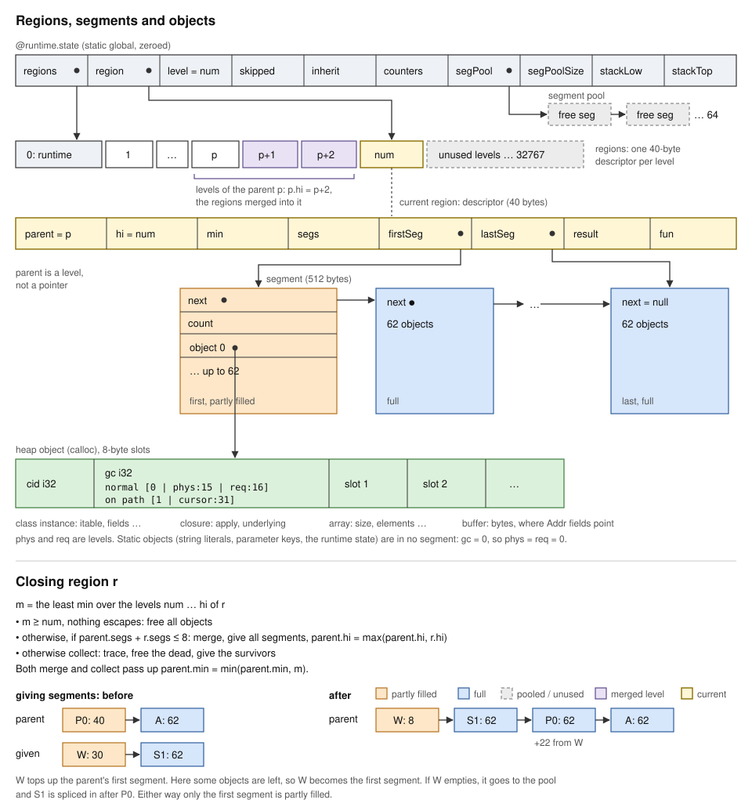

# Memory Management for the LLVM Backend

This document designs memory reclamation for the 64-bit LLVM backend. It
builds on an earlier design, explicit function regions with deferred
promotion, and changes it in these places:

1. Region functions are chosen by the backend, by default every function that
   can allocate, and adjusted in backend configuration, not by a language
   annotation.
2. Cleanup traces only the objects of the closing region.
3. Cleanup needs no work list. The trace reverses pointers instead, and the
   only memory cleanup can take is index segments for survivors that move to
   an older region.
4. Survivors move to the region that requires them by handing over storage
   segments.
5. A region from which something escapes merges into its parent while a
   budget allows, and only collects when the budget is used up.
6. An object that makes up the result of a function is allocated directly in
   the region the result goes to.

The design is single-threaded, like the rest of the native runtime.

Regions are an optimization of peak memory, the resident set size (RSS). A
program without region functions is correct and frees nothing before it exits.
Regions let memory be reused, so a long-running program can stay within a
bounded RSS. Like other optimizations, they never change what a program does,
only how much memory and time it takes.

## Overview

The heap is a stack of regions. A call to a region function opens a child
region and closes it on return. All allocations go into the current region.

Every object records two region levels. Levels number the open regions from
the oldest, like depths (see [Levels](#levels)):

- `phys`: the region whose storage holds the object.
- `req`: the oldest region the object must outlive. It compares like `phys`
  or an older level. A level owned by the same region as `phys` compares like
  `phys`, even when it is numerically higher (see [Levels](#levels)).

A heap store `b.f = c` lowers `c.req` to `b.req` if needed. When a region
closes and nothing escapes it, it frees all its objects. Otherwise it merges
into its parent while a budget allows, or collects: objects whose `req` is
older than the region are escape roots, their requirement spreads to the
region's objects they reach, and the region frees every object still required
only by itself and hands the survivors to its parent.

Safety does not depend on scanning the stack. A frame only ever holds
pointers into its own region or an ancestor region, and a region outlives
every frame that can see it.

## Region boundaries

`@region` cannot be part of the language because only the native backend can
honor it. Region functions are chosen by the backend and adjusted in backend
configuration instead:

- `--region-policy all`, the default, makes every function a region function,
  except `main`, the functions of the runtime, and the functions that cannot
  allocate (see [Functions that cannot allocate](#functions-that-cannot-allocate)).
- `--region-policy scalar` makes only the functions returning a primitive
  value other than `Unit` region functions, and `--region-policy none` none.
- `--region <function>` makes a function a region function under any policy.
  The flag can be repeated. The `jo` tool does not build LLVM apps yet, so
  these options go on the `jo compile --llvm` command line.

### Functions that cannot allocate

A function that cannot allocate would always close an empty region, so it
opens none. Before codegen, a fixpoint over the call graph finds the functions
that may allocate: they build a record, call the allocator of the runtime,
call a function indirectly, or call a function that may allocate. A branch that
ends in a call that never returns, like the failure of an assertion, does not
count, since the program stops there. Without that rule, the message of the
bounds check would make every array access open a region. Boxing a `Bool` or
a `Byte` does not allocate: it returns a shared box.

Leaving out a region is always safe. It only merges the function's
allocations into its caller's region.

### The runtime region

Level 0 is the runtime region. It holds what the runtime sets up before the
program starts, such as singleton objects, program arguments and the standard
streams, and everything `main` allocates outside region functions. The runtime
region never closes: the program exits instead, so freeing it would gain
nothing.

An object that escapes to level 0 lives until the program exits.

### Tail-recursive functions

Jo's tail-call optimization turns a self-recursive function into a loop. A
region function rewritten this way is out of scope for now. Later the compiler
can warn that the region marking is ignored for such a function.

Merging regions is always safe. It only delays reclamation. The backend
therefore may ignore a region boundary when it is inconvenient, for example
beyond the level limit.

## Object header

Slot 0 of every heap object is `cid: i32 | gc: i32`. The `gc` half has two
forms:

```
normal    [0 | phys: 15 | req: 16]
on path   [1 | cursor: 31]
```

The on-path form is used only during cleanup (see below).

Level 0 is the runtime region. Levels are limited to 32767 by the `phys`
field. A region function called at the limit runs in the current region
instead of opening a new one.

Since active regions form a chain, the lowest common ancestor of two active
regions is the older one. The barrier therefore compares levels. A region
descriptor is never needed per object.

## Static data

String literals, shared boxes, interface tables and other globals are not heap
objects. They carry a header with `phys = 0` and `req = 0`, so the barrier never lowers them
and the trace never enters them.

A string literal is a static `Raw` object whose `content` points into a static
buffer object. Context parameter keys point into static buffers too. Program
arguments are copied into heap buffers at startup, and memory handed to the C
library, such as the alternate signal stack, comes from `calloc`.

## Shared boxes

A primitive value is boxed when it flows into `Any`, for example into a
generic container. A program that stores numbers in an `Array[Int]` or folds
over characters allocates a box for every such value, and these boxes make up
much of the heap. In deflate, 1.7 million of 2 million allocations were boxes
of `Int`.

Most boxed values are small, so codegen emits their boxes as static data, one
constant array per box class:

- `Int` in [-128, 1024)
- `Char` in [0, 256)
- every `Byte`
- `false` and `true`

The ranges cover bytes, characters, small counters and the lengths of deflate.
They hold 55% of the boxed `Int` values in deflate and 27% in forth, and every
boxed `Char` in deflate and html5. `Layout.scala` defines them.

A shared box is laid out like a heap object of its class, with `gc = 0` in the
header like a string literal. The `Boxing` phase calls `boxInt`, `boxChar`,
`boxByte` and `boxBool` of `Platform.jo` instead of the box constructors. For a
value in range they return the address of its box in the array, and otherwise
allocate a new box. Once optimized, boxing a small `Int` is an add, a compare
and an address computation. `Long` and `Float` are always boxed anew. The
32-bit backends do not share boxes.

The barrier never lowers a shared box, since its `req` is 0. The trace of a
closing region never enters it, since its `phys` is 0. The arrays are in
read-only memory, so a stray write to a header faults.

Only the arrays of reachable box functions are emitted. They take about 60 KB
of the executable, mostly the `Int` array, and the loader relocates their
interface table pointers at startup. A hello world grows from 38 KB to 96 KB
and still starts faster than with boxes allocated at startup.

Sharing is invisible to programs. A box is immutable: its constructor writes
`value` once, and nothing writes into a box afterwards. Jo has no reference
equality and no identity hash. Equality, hashing, ordering and printing go
through the methods of the unboxed type, and a pattern match reads the class
id and the value. The runtime compares addresses with `sameRef` only for
context parameter keys and region segments, never for boxes.

On the jtk projects, under the default policy, shared boxes halve the peak
RSS or better and make the programs faster, with the same output:

| Project | Time before → after | Peak RSS before → after |
|---|---|---|
| html5 smoke | 2.6–2.8 → 1.9–2.2 s | 186 → 93 MB |
| deflate bench | 0.60–0.73 → 0.25–0.28 s | 60 → 34 MB |
| forth smoke | 0.22–0.23 → 0.17–0.18 s | 37 → 29 MB |
| sat smoke | 0.22–0.25 → 0.06–0.07 s | 30 → 7 MB |

## Allocation

`GC.alloc` stays the single allocation entry point. It allocates the object
with `calloc`, writes `phys` and `req` as the current level, and appends the
object to the current region.

A region stores its objects in a linked list of fixed-size segments. Each
segment is an array of object pointers with a count. Allocation fills the
first segment and puts a new one in front when it is full. This is the only
place the region storage grows.

Only the first segment of a region is ever partly filled. The segment size is
therefore not a tuning knob: the index costs one word per object, plus at most
one partly filled segment per open region. A small segment keeps that waste
low for deep recursion through region functions.

Every heap allocation is an object with a header. A byte buffer, for example
of `StringOps.bytes`, `floatToStr` or `cString`, comes from `allocBuffer` and
is an object with the buffer class id. `Bytes` are objects with the bytes
class id. Neither layout has pointers.

A string's `content` field points into its buffer, past the header. The layout
table marks such a slot as interior with a fixed offset, and the trace
subtracts the offset to find the object. Every `Addr` field is such a slot,
so an `Addr` stored in a heap object must point into a buffer or a static
buffer, never into C memory or past the start of the content. The trace checks
the class id of the buffer and stops the program if the rule is broken.
Buffers hold no pointers, so the trace lowers them without descending, and an
interior slot is never reversed.

`calloc` keeps object addresses stable, and `free` frees objects one at a
time. A size-class allocator can replace it later without changing the
design.

## Pointer layout

The trace needs the pointer slots of every object. Codegen knows every class,
closure, array and box layout and emits a table indexed by class id. An entry
describes one of:

- fixed slots: a list of slot indices that hold pointers.
- reference array: every element is a pointer.
- no pointers: `Bytes`, boxed numbers, raw buffers.

The `itable` and `apply` slots point to static data and are not listed.

## Write barrier

Only mutation stores need the barrier:

```
store(b, slot, c):
  if c != null and c.req > b.req:
    c.req = b.req
    regions[c.phys].min = min(regions[c.phys].min, b.req)
  slot = c
```

The last line records the promotion for the close of `c`'s region (see
[Knowing that nothing escapes](#knowing-that-nothing-escapes)).

Initialization stores need no barrier. A new object `b` has `req` equal to the
current level, and any `c` it can refer to already has `c.req` at that level or
older. An object placed in an older region is the exception (see
[Placing results](#placing-results)).

Codegen already routes every field store through one helper, `storeField`,
which tells initialization from mutation. The barrier goes there.

Stores performed by the runtime also need the barrier:

- `RefArray.setUnchecked` writes array elements with `writeAddr`. It gets a
  barrier-aware primitive `writeRef`, which the 32-bit backends rewrite to a
  plain store.
The barrier changes only the stored object. Propagation to its children is
deferred to cleanup.

Stores into `Addr` fields get no barrier. Such a field holds memory outside
the regions, like the runtime state, or an interior pointer, which is never
mutated.

## Region entry and exit

A region function compiles to:

```
enter()                     // push a region above the current one's levels
result = body
if result is a pointer:
  require(result, p)        // p: the parent's level, recorded like the barrier
close()
return result
```

Codegen emits the exit sequence before every `ret` of the function, including
labeled returns. Jo has no exceptions and `abort` exits the process, so there
is no unwinding path.

Records and tuples are heap objects, so a result has at most one pointer to
promote.

## Cleanup

Cleanup runs no user code and traces only the objects of the closing region
`r`. It allocates no objects and no work list. The one thing it can allocate
is an index segment: a collect appends a survivor required by an older region
to that region (see `append o to q` below), which takes a new segment when
the first segment of that region is full. The segment comes from the pool,
or from `calloc` when the pool is empty. This is bounded by the survivors
that move: one segment per 62 of them, plus one partly filled segment per
destination region, the same index those objects had in `r`, whose segments
go back to the pool at the end of the sweep. Merges and the survivors handed
to the parent reuse the segments of `r`.

### Why tracing stops at the region

The earlier design follows pointers into ancestor regions. That is not
needed. When the trace reaches an object `e` in an ancestor region `Q`, it
lowers `e.req` and stops. Then `e.req` is below `Q`'s level, so `e` is an escape root of
`Q`, and its children are traced when `Q` closes. Until then they stay in a
live region and are safe.

An object `d` of `r` that `e` points to is covered too. The store into `e` ran
the barrier, so `d` survives `r` and moves up with the survivors. When `Q`
closes, the trace from `e` reaches `d` and lowers it further.

### Algorithm

A close that collects (see [Merging regions](#merging-regions) for when):

```
collect(r):
  for o in r.objects:
    if o.req < r.num:             // escape root
      lower(o, o.req)

  for o in r.objects:             // sweep
    if o.req >= r.num:
      free(o)                     // never dereferences other objects
    else if o.req >= r.parent.num:
      o.phys = r.parent.num
      keep o                      // pack survivors at the front
    else:
      q = owner(o.req)            // required by an older region
      o.phys = q.num
      append o to q
  release the empty segments
  give the survivor segments to r.parent
```

`owner(l)` is the open region whose levels contain `l`. It walks the parent
levels up from `r.parent` until it reaches a level at or below `l`. The sweep
caches the last answer, since survivors often share a `req`. A survivor that
goes directly to an older region is not visited again by the closes in
between.

`lower(root, d)` lowers `req` to `d` for everything in `r` reachable from
`root`. It is a depth-first traversal with pointer reversal
(Deutsch-Schorr-Waite). When the traversal descends into a child, the field
that pointed to the child holds the parent instead. The chain of reversed
fields is the traversal stack, and each field is restored on the way back.

```
lower(root, d):
  prev = null
  cur = root
  cur.gc = onPath(cursor = 0)
  loop:
    i = cur.cursor
    if i < pointerCount(cur):
      c = field(cur, i)
      if c != null and not c.onPath and c.phys >= r.num and c.req > d
          and pointerCount(c) > 0:
        field(cur, i) = prev      // reverse the edge
        prev = cur
        cur = c
        cur.gc = onPath(cursor = 0)
      else:
        if c != null and not c.onPath and c.req > d:
          c.req = d               // in an ancestor or a leaf: lower only
          record(c.phys, d)       // for the cleanup of its owner
        cur.cursor = i + 1
    else:
      cur.gc = normal(phys = r.num, req = d)
      if prev == null: return
      j = prev.cursor
      up = field(prev, j)         // restore the reversed edge
      field(prev, j) = cur
      cur = prev
      prev = up
      cur.cursor = j + 1
```

An object on the path is always in `r`, and its `req` is the current `d`. Both
are implied, so its whole `gc` half is free to hold the cursor. A 31-bit
cursor covers any array. The tag bit is checked first, because the levels of
an object on the path are not stored.

All younger regions are closed, so an object is in `r` exactly when its
`phys` is `r.num` or above. On the way back the trace writes `r.num`, which
compares like the object's former `phys`.

The traversal descends only into an object with `req > d`. That condition also
replaces the `processed` map of the earlier design: an object already lowered to `d` or
shallower has nothing left to propagate. Cycles end at objects on the path.

### Cost

- Space: no work list. A collect may take index segments for the survivors
  that move to an older region, as described above.
- Opening and closing a region that allocates nothing costs two calls and a few
  loads and stores. Descriptors and segments are reused, so it does not call the
  C allocator.
- Closing a region from which nothing escapes visits each object once, to free
  it. Each dead object costs one `free`.
- A merge costs the scan of the region's levels and at most one segment's worth
  of copied pointers, however many objects the region has.
- A collect visits each object of the region twice, once to find the escape
  roots and once to free or keep them.
- The trace visits the objects of the region reachable from escape roots. Within
  one close, an object is traversed once per lowering of its `req`, which is
  once in the common case. Objects outside the region are never traversed.
- A survivor required by an older region moves there directly, and the
  closes in between do not visit it again.
- A survivor required only by the parent, such as a returned value, moves up
  one region per collect and is visited by the sweep of each. While it is
  returned further, it is also traced again: `require` lowered its `req` only
  to the level of the parent, which is too young for the next close.

So a returned object costs work at every collecting boundary it passes through
alive, unless it was allocated in its final region (see
[Placing results](#placing-results)). A region pays off when most of what it
allocates dies before it closes.

The worst case is a recursive function that returns what it builds, for
example

```
def build(n: Int): Option[Node] =
  if n == 0 then None
  else Some(new Node(n, build(n - 1)))
```

Without placing results, every node survives every enclosing close. The first
closes merge, until the list exceeds the merge budget of about 500 objects.
From then on every close collects and traces the whole list, so building a
list of `n` nodes costs O(n²). With temporaries at every level, `n = 16000`
takes 4.35 seconds on an x86-64 machine. With placing results, the nodes are
allocated in the region of the first caller, each level frees only its
temporaries, and the same run takes 0.07 seconds.

Placing results misses a result built in a loop, since a variable assigned
more than once is never marked. A variant of `build` that recurses first and
then adds 10 nodes to the result in a loop, with a temporary per node, takes
50.7 seconds for 8000 levels under `all`, and 0.02 seconds under `none`. The
memory statistics show `traced=640066822` for 240179 allocated objects, and
print the `traced` hint. Both fixes the hint names help: building the list in
one loop of a single call takes 0.05 seconds, and `--region-policy none` with
a `--region` for a function that calls `build` takes 0.02 seconds and frees
all but 22 objects.

### Choosing the policy

The default policy `all` gives the lowest peak RSS. On the jtk projects it
costs between nothing and 1.4 times the time without regions, and cuts peak
RSS by 1.4 to 19 times. These numbers were taken before shared boxes (see
[Shared boxes](#shared-boxes)):

| Project | Time none → all | Peak RSS none → all |
|---|---|---|
| html5 smoke | 1.9–2.5 → 2.3–2.8 s | 985 → 186 MB |
| crypto smoke | 0.32 → 0.29–0.32 s | 172 → 9 MB |
| deflate bench | 0.31 → 0.45 s | 85 → 60 MB |
| forth smoke | 0.15 → 0.21 s | 73 → 37 MB |
| sat smoke | 0.13 → 0.18 s | 56 → 30 MB |
| url smoke | 1.24–1.50 → 1.21–1.34 s | 53 → 16 MB |

The jtk projects are not the worst case. A small function that is called
very often and can allocate pays for `enter` and `leave` on every call, even
if it allocates only on a path that never runs. In a recursive `fib(32)` that
reads its base cases through such a function, which prints a message for a
negative value, `all` takes 0.17–0.18 seconds and `none` 0.04 seconds, about
4 times as long. Such a function is a region function only because it may
allocate.

To find out where the memory of a program goes, see
[Memory statistics](#memory-statistics).

`all` can cost time. `--region-policy none` with a `--region` for a few
functions trades some of it back. The steps to pick the functions are in the
[memory guide](../../docs/usage/guides/memory.md#trading-time-back). On the
jtk deflate bench, `deflate 6 1024`, one region function keeps the peak RSS
of `all` at nearly the time of `none`:

| Build | Time | Peak RSS |
|---|---|---|
| `all` | 1.02 s | 136 MB |
| `none` | 0.77 s | 163 MB |
| `--region-policy none --region Bench.words` | 0.82 s | 135.5 MB |

`--region` accepts only top-level functions outside the runtime. A row of a
method, like `forth.Vm$loop`, cannot be named, and the fix there is in the
program. Removing a single region from `all` does not lower RSS and may not
save time, since its allocations merge into the caller's region. That is why
there is no `--no-region`.

## Memory statistics

The runtime always counts allocations, frees, objects that go to the runtime
region and the outcomes of closes. The counts are kept in the slow paths,
except a few increments in the allocation functions. With the environment
variable `JO_MEMSTATS` set to a value other than the empty string and `0`,
a program prints them on stderr when it exits normally or by `abort`.
`JO_MEMSTATS=0` turns them off, like leaving the variable unset. It does not
print them when it runs out of memory or overflows the stack, because printing
allocates.

The report has one record per line, a kind followed by `key=value` fields:

```
jo-mem summary peak-rss-kb=4740 allocated=24034 freed=10004 runtime-region=14030 skipped-enters=0
jo-mem to-runtime direct=6021 store=8009 trace=0 return=0
jo-mem closes free=3 merge=444 collect=7581 traced=0
jo-mem hint rebuild with --mem-profile to attribute these to functions
```

- `summary`: the peak RSS in KB, the objects allocated and freed, the
  objects in the runtime region at exit, and the enters skipped at the level
  limit. After an `abort`, the objects of the open regions are neither freed
  nor in the runtime region, so `allocated - freed` exceeds `runtime-region`.
- `to-runtime`: the objects allocated directly in the runtime region, and
  those promoted to it by a store into an object there, by the trace of a
  closing region, and by a return to `main`. These stay until the program
  exits. `direct` counts what `main` allocates, since it runs in the runtime
  region, and the results of the functions it calls.
- `closes`: the closes that freed everything, merged and collected, and
  `traced`, the objects whose `req` the traces of collecting closes lowered,
  besides the escape roots. An object traced at every close it passes through
  counts once per close, so `traced` far above `allocated` means repeated
  tracing (see [Cost](#cost)). The trace counts in a local variable and adds
  it to the total once per collect.

Built with `--mem-profile`, the program also reports the region functions
responsible, by name. The backend then emits the names of the region
functions and classes, and nothing else changes. Each region function gets
counters, allocated at startup only when `JO_MEMSTATS` is set. Codegen
numbers the region functions and `enter` stores the number in the region
descriptor, so a store is charged to the function of the current region, a
trace to the function of the closing region, and a return to `main` to the
function whose region closes.

```
jo-mem promoted kind=store count=5000 fun=memapp.remember at=app.jo:9 into=jo.Array caller=memapp.main
jo-mem promoted kind=trace count=5999 fun=tr.link at=tr.jo:5 caller=tr.main
jo-mem promoted kind=return count=3000 fun=jo.Range.RangeIterator$next$bridge at=lib/Range.jo:55 caller=memret.main
jo-mem region objects=10044 fun=memapp.accumulate at=app.jo:12 caller=memapp.main
jo-mem traced objects=896724 fun=memquad.build at=quad.jo:10 caller=memquad.main
```

- `promoted kind=store`: the objects the function's stores promoted to the
  runtime region. `into` is the class of the object stored into last.
- `promoted kind=trace`: the objects the trace of the function's region
  promoted to the runtime region, besides the escape roots.
- `promoted kind=return`: the results the function returned to `main`, which
  `leave` promoted to the runtime region. `caller` is always `main`. A result
  allocated in the region of `main`, the common case, counts in `direct`
  instead.
- `region`: the most objects the function's region held at once. It is
  measured in segments, so `objects` is the segment count times 62, and
  overestimates by up to 61.
- `traced`: the objects the traces of the function's region lowered, the
  per-function share of `traced` in `closes`. It saturates at 2^31 - 1.

`fun` is the innermost region function. `caller` is the nearest function of
an enclosing region that is not a library function, at the last promotion or
at the peak, so it names user code even when `fun` is in the library. A
function whose name starts with `jo.` counts as a library function. Each kind
has up to 10 rows, the largest first, and leaves out rows under 1000 objects.

Past the level limit, `enter` opens no region, so the calls of a deep
recursion share the region at the limit. A nonzero `skipped-enters` then
explains a large `region` row of a recursive function.

After the rows come hints, written in the runtime. Each hint is printed only
when a row of its kind is:

- `store`: a value stored into a container of the runtime region stays even
  after it is overwritten. Moving the container helps only if its function
  returns well before the program ends. Otherwise avoid a new object per
  store. The hint lists the values with shared boxes, taken from the ranges
  of `Layout`.
- `trace`: a structure reachable from the runtime region moved there when
  the region closed. Either a store linked it to an object there, or it is a
  result returned to `main`. The root of a returned result counts in
  `return`, and the objects it reaches count in `trace`.
- `region`: what the function allocates and the results returned to it stay
  until it returns. A loop body moved into a function frees its garbage per
  iteration. If the body already is one, stores into this function's
  containers or the results of the body keep the objects.
- `library`: a `store`, `trace` or `region` row names a `jo.*` function. The
  fix is in how the caller uses it, for example a `while` loop in place of
  `Iterator.fold` over a long input.
- `main`: printed when `direct` or `return` is at least 1000, also without
  names. What `main` allocates, and the results returned to it, stay until
  exit. The body of each loop of `main` belongs in a function, with the calls
  whose results it uses. Moving the whole loop only moves the objects into
  the region of the new function. This hint also covers a `return` row that
  names a `jo.*` function, so the `library` hint is left out for it.
- `traced`: printed when `traced` is more than 4 times `allocated`, also
  without names. The likely cause is a recursive function whose result is
  built in a loop, which placing results misses. The hint suggests building
  the result with a loop or an accumulator in one function, or
  `--region-policy none` with a `--region` for a function that calls the
  recursive one.

The counters of a function are 12 `i32` fields, in this order: `store`,
`trace`, `peakSegs`, `peakCaller`, `into`, `caller`, `storeBase`,
`traceBase`, `return`, `returnBase`, `traced` and `tracedCaller`. The base
fields hold the counts at the last growth report. `Regions.jo` names the
offsets.

A program that never exits never prints this report, so with `JO_MEMSTATS`
set the runtime also reports while the region grows. When the runtime region
reaches 1024 segments, about 63000 objects, and each time it doubles after
that, the program prints a `growth` line:

```
jo-mem growth runtime-region=126915 peak-rss-kb=8576 direct=0 store=63488 trace=0 return=0
jo-mem growth-promoted kind=store count=63488 fun=memsrv.handle at=server.jo:14 into=memsrv.State caller=memsrv.main
```

`runtime-region` and `peak-rss-kb` are totals, the other counts are the
promotions since the previous `growth` line. Built with `--mem-profile`, the
`growth-promoted` rows follow, like the store, trace and return rows of the
exit report but counting since the previous growth report. The first report with
a row adds a `growth` hint on what keeps the region growing. Without names,
the first report suggests rebuilding instead. The first report whose `direct`
or `return` is at least 1000 adds the `main` hint.

A single growth report soon after startup can be data the program builds once
and keeps, such as a table it loads. Repeated reports while the program serves
requests mean the region grows without bound.

Any other region can grow without bound too, for example the region of a
function that loops forever and keeps what the calls of the loop return to it.
When a region other than the runtime region reaches 1024 segments, and each
time that threshold doubles after that, the program prints a `growth-region`
line for the largest open region:

```
jo-mem growth-region objects=63430 peak-rss-kb=4992 fun=memserve.serve at=serve.jo:12 caller=memserve.main
```

`objects` counts the objects of that region. Built with `--mem-profile`, the
line names its function and caller, and the first one adds the `region` hint
of the exit report. Without names, the first report suggests rebuilding
instead. The threshold is shared by all regions other than the runtime region,
so a function that builds the same large temporary structure on every call
is reported once.

The runtime notes the thresholds when a segment is added, and prints the report
at the next return of a region function, once the state is consistent. The
report runs in a region of its own, so it adds nothing to the promotions or to
the runtime region. Its strings still count in `allocated` and `freed`.

To reduce the peak RSS of a program:

1. Run it with `JO_MEMSTATS=1`. A large `direct` points to allocation in
   `main`. Large `store`, `trace` or `return` counts point to promotions.
2. Rebuild it with `--mem-profile` and run it again.
3. Fix the top row, following its hint.
4. Run it again and compare `peak-rss-kb`.

## Merging regions

A close does not have to collect. It can merge the region into its parent and
leave the work to a later close. This makes small regions cheap, which a
policy that opens a region in every function needs.

### When to merge

| At close | Action |
|---|---|
| Nothing escapes | Free all objects |
| Something escapes, and the merge budget allows it | Merge into the parent |
| Something escapes, and the budget is used up | Collect |

Merging a region with no escapes gains nothing. Each dead object costs one
`free` either way, and merging only holds the memory longer.

Merging pays when something escapes. The close skips the trace and the sweep.
A survivor is then visited at one collecting close, not at every enclosing
close. A recursive builder costs O(n) until the budget is reached.

The budget bounds the garbage held by merging. A region merges only if it and
its parent have at most 8 segments together, about 500 objects. Otherwise it
collects. A loop whose own region never closes therefore holds at most about
500 merged objects.

A merge hands the region's segments to the parent like a collect hands the
survivors: the partly filled first segment tops up the parent's, and the full
ones are spliced in. It copies at most one segment's worth of pointers.

### Levels

A merge splices the region's segment list into the parent's. That is O(1), but
the merged objects keep their `phys` and `req`. With plain depths, the next
child reuses the merged region's depth and the barrier misses an escape:

```
b: merged object, stale req = d+1, really lives until d closes
c: new object in the new child, req = d+1
b.f = c   →  c.req > b.req is false, so c is not lowered
the child closes  →  c is freed, and b.f dangles
```

Rewriting the merged headers would cost O(N). Instead, `phys` and `req` hold
levels. Each region has a level `num` and the highest level merged into it,
`hi`:

```
enter:            child.num = parent.hi + 1
                  child.hi  = child.num
merge c into p:   if c is non-empty: p.hi = max(p.hi, c.hi)
collect r:        survivors get phys = parent.num
```

Every object's `phys` and `req` lie in `[owner.num, owner.hi]`, and new
children are numbered above `owner.hi`. So no open region has a level in
`(owner.num, owner.hi]`, and a stale level compares like `owner.num` against
every open or future region. The barrier stays unchanged. If the real owner of
`c` is younger than that of `b`, then `b.req < c.owner.num <= c.req`, so the
barrier fires. Between stale levels of the same owner, it may lower `req`
without need, which is safe.

Close tests levels against the range of the closing region `r`. All younger
regions are closed, so an object is in `r` exactly when `phys >= r.num`. An
escape root has `req < r.num`. The sweep frees objects with `req >= r.num`.

Levels grow only when a non-empty region merges, and they are reused when a
region closes, like depths. Each merge of a non-empty child uses up a level
of its parent, until the parent holds 8 segments and its children collect
instead. A collect does not give levels back while the parent is open. So a
frame that calls many small region functions whose results it keeps uses
many levels, and deep recursion through such frames reaches the limit of
32767. In `wide`, a recursive function that calls a helper 300 times per
frame and keeps each result, every frame uses about 110 levels, and the limit
is reached at a recursion depth of about 296.

At the limit, `enter` stays in the current region, as for depths before, and
counts the call in `skipped-enters`. All deeper calls then share the region
at the limit, which frees nothing until that frame returns. At depth 2000,
`wide` skips 1025022 enters, and its region at the limit holds 2048976
objects at once, so the report shows a large `region` row for `wide` and
`growth-region` lines while it runs. The header keeps its layout.

### Knowing that nothing escapes

Pass 1 of a collect finds the escape roots by scanning every header. To know
whether anything escapes without it, each region descriptor records `min`, the lowest level an object of
the region was promoted to. `enter` sets `min` to the region's own `num`. The
barrier records the promotion without a second branch:

```
store(b, slot, c):
  if c != null and c.req > b.req:
    c.req = b.req
    regions[c.phys].min = min(regions[c.phys].min, b.req)
  slot = c
```

`require` on the result records its promotion the same way. The `min` is a
backend intrinsic of the LLVM runtime that emits `llvm.smin.i32`, so it lowers
to `cmp` and `cmov` at every optimization level, not to a branch. A promotion
that stays within the owner region records a level at or above its `num`,
which signals nothing.

The descriptors form an array indexed by level, `regions[level]`. So `enter`
takes `&regions[parent.hi + 1]`, and the barrier finds the descriptor with one
address computation. At 32768 levels and 40 bytes per descriptor, the array
takes 1.25 MB of address space, and only the pages for the levels in use become
resident.

At the close of `r`, let `m` be the minimum of `min` over `[r.num, r.hi]`.
After a merge, the barrier may record into the slot of a merged child, at a
level in `(p.num, p.hi]`. No open region uses those slots, so the scan of the
range finds it. Something escapes `r` exactly when `m < r.num`. A merge then
passes `m` up:

```
parent.min = min(parent.min, m)
```

An object can escape several regions at once, but the barrier records only at
the innermost one. The invariant is: if an object `o` has `req` below the
`num` of its owner region, the minimum over the owner's range is at most
`o.req`. It holds for every step that lowers a `req` or moves an object:

- The barrier and `require` record the new `req` at the owner.
- A merge keeps the child's records in the parent's range, and passes `m` up
  for the objects that escape the parent too.
- A collect moves a survivor to the parent only if its `req` is at or above
  the parent's `num`, so it does not escape the parent. Any other survivor
  moves to the region owning its `req`, where it does not escape either.
- `lower` lowers an object `e` in an ancestor to the `req` of its root, and
  records it at `e`'s owner like the barrier.

## Placing results

Without help, a returned object is allocated in the callee's region and
promoted at its close. If it is returned again, it is promoted again, one
level per close. Placing results allocates it directly in the region the
result goes to.

Each region records its **result level**, the level of the open region its
function's result goes to. By default that is the caller's level. A call whose
result becomes part of the caller's result inherits the caller's result level
instead, so a value returned through many levels is allocated where the
outermost of them keeps it.

A flow-insensitive analysis marks the values that must end up in the result
region of a function:

- the returned values
- the value assigned to a marked variable
- the fields of a marked object
- the values stored into the object of a marked variable
- the arguments of a marked call that flow into the callee's result

A variable assigned more than once is never marked, nor is a parameter that
is assigned. The analysis cannot tell which of its values is returned, and
marking all of them would keep the overwritten ones in the result region,
up to one per iteration of a loop around the call.

The marked parameters are the summary of a function for its callers. A
constructor stores its parameters into `this` and returns it, so the summary
covers constructors too. Summaries are computed on demand and cached. A call
back into a function whose summary is still being computed sees no summary,
so under mutual recursion the summaries depend on the order of analysis.
Like the rest of the analysis, this only affects performance.

A marked allocation goes to the result level, and a marked call makes its
callee inherit it. Allocations and calls inside a loop stay in the current
region, since a loop may allocate many values of which only one is returned.

```
call f, marked:   inherit()          // the next enter takes the result level
                  f(args)
enter:            child.result = inherit ? current.result : current.num
marked alloc:     allocResult(size)  // in regions[current.result]
```

A call site sets `inherit` only when the callee opens a region, so the flag is
always consumed by the callee's `enter`. Past the level limit, the current
function opened no region, and `allocResult` allocates in the current region.

Placement only affects performance. An object in the result region is older
than the current region, so its initializing stores go through the barrier,
except a function reference, like the `apply` of a closure, which is not a
heap object. If a marked value does not escape after all, it stays in the
result region until that region closes.

Placing results is on under `--region-policy all`, and `--place-results` turns
it on for the other policies.

## Interaction with the optimizer

The design holds under LLVM's optimizations:

- Inlining a region function keeps `enter` and `leave`, which are explicit
  calls. Losing a boundary would only merge regions, which is safe.
- The barrier is inlined code with a store. Removing a dead heap store leaves
  the barrier's promotion in place, which is conservative.
- No load can move across `leave`, because LLVM sees an opaque call that may
  write memory.
- Allocations are never removed, because every object escapes into its region's
  segment.

`enter` and `leave` are marked `noinline` to keep the boundary opaque.
The barrier may be inlined.

## Limitations

- Under `--region-policy none` without `--region`, a program frees nothing
  before `main` returns.
- Objects promoted to the runtime region stay until the program exits.
- Garbage accumulates inside a long-running region, for example in a loop.
  Moving the loop body into a region function reclaims it per iteration.
- A value stored into a long-lived object is promoted to that object's region,
  and stays there after the field is overwritten. For an object created by
  `main`, that is the runtime region. Before shared boxes, most of the peak
  RSS of html5 under `all` was such values, about 1.5 million objects.
- A returned value that placing results misses, for example one built in a
  loop, is traced again at every enclosing close that collects (see Cost).
- A merge holds the garbage of the merged region until a later close, up to
  the budget of 8 segments per region.
- A removed escape stays promoted until its destination closes, as in the earlier design.
- `calloc` per object is slower than the current bump allocator.
- Memory statistics charge a promotion to the innermost region function, and
  count objects, not bytes. Telling library functions apart by the `jo.`
  prefix of their names is a heuristic.
- A growth report is printed at the next return of a region function, so a
  loop in `main` that calls none reports late, at the next return or at exit.
  A region that reached the threshold and closed before then is not reported.

## Later: a faster allocator

Allocating each object with `calloc` and freeing it with `free` is simple and
correct, but slower than the bump allocator the backend uses today.

A faster scheme gives each region its own large chunks and bump-allocates
objects in them. Freeing a whole chunk at once is cheap, but a chunk can only be
freed when none of its objects survived. A survivor keeps its address, so it
stays in the chunk of the closed region. The allocator must then count the
live objects of each chunk and free the chunk only when the count reaches zero.

This changes only the allocator, not the region design.

## Implementation

The runtime is `runtime/native/libc/Regions.jo`. Region descriptors and
segments come from `calloc`:

- The region descriptors form one array indexed by level, allocated at
  startup. A descriptor is 40 bytes, so the array takes 1.25 MB of address
  space, and only the pages of the levels in use become resident. `enter`
  takes the descriptor above the current region's levels. The last field,
  `fun`, numbers the function that opened the region, for the memory
  statistics.
- A segment is 512 bytes: a `next` pointer, a count and 62 objects. Only the
  first segment of a region is partly filled. Released segments go to a pool
  of at most 64.
- A region gets its first segment on its first object.
- `min` is computed with an intrinsic of the LLVM runtime, `minInt`, which
  the backend emits as `llvm.smin.i32`. It lowers to `cmp` and `cmov` at every
  optimization level.

A region call that allocates nothing therefore allocates nothing at all. It
costs the two calls of `enter` and `leave` and a few loads and stores. Objects
are allocated with `calloc` and freed with `free`.

### Memory structure



The runtime state is a static global. It points to the descriptor array and
to the current region, and each region records the level of its parent, down
to the runtime region at level 0. Segments index the objects of a region. They
hold pointers, never the objects themselves. `counters` stands for the fields
of the memory statistics.

```
@runtime.state (static, zeroed)
┌───────────┬──────────┬───────┬─────────┬─────────┬──────────┬───────────┬─────────────┬──────────┬──────────┐
│ regions ● │ region ● │ level │ skipped │ inherit │ counters │ segPool ● │ segPoolSize │ stackLow │ stackTop │
└─────┼─────┴────┼─────┴───────┴─────────┴─────────┴──────────┴─────┼─────┴─────────────┴──────────┴──────────┘
      │          │                                                  └──► free segment ──► …   (at most 64)
      ▼          ▼
regions: one descriptor per level (40 bytes each)
┌───────────┬───┬───┬───┬─────┬─────┬─────┬──────────────────┐
│ 0 runtime │ 1 │ … │ p │ p+1 │ p+2 │ num │ unused … 32767   │
└───────────┴───┴───┴───┴─────┴─────┴──┼──┴──────────────────┘
                     └─ levels of p ─┘ │   p.hi = p+2: the regions merged into p
                                       ▼
current region descriptor
┌────────────┬─────────┬─────────┬──────────┬────────────┬───────────┬────────────┬─────────┐
│ parent i32 │ hi i32  │ min i32 │ segs i32 │ firstSeg ● │ lastSeg ● │ result i32 │ fun i32 │
└────────────┴─────────┴─────────┴──────────┴─────┼──────┴─────┼─────┴────────────┴─────────┘
                                                  │            └───────────────┐
                                                  ▼                            ▼
                              segment (512 bytes)     segment     segment (last)
                              ┌──────────────┐        ┌────────┐       ┌───────────┐
                              │ next ●       ├───────►│ next ● ├─► … ─►│ null      │
                              │ count        │        │ 62     │       │ 62        │
                              ├──────────────┤        ├────────┤       ├───────────┤
                              │ object 0 ●   │        │ …      │       │ objects   │
                              │ … up to 62   │        │ full   │       │ full      │
                              └──────┼───────┘        └────────┘       └───────────┘
                                     ▼  first, partly filled
heap object (calloc), 8-byte slots
┌─────────┬───────────────────────────┬────────┬────────┬─────
│ cid i32 │ gc i32                    │ slot 1 │ slot 2 │ …
│         │ normal [0|phys:15|req:16] │        │        │
│         │ on path [1|cursor:31]     │        │        │
└─────────┴───────────────────────────┴────────┴────────┴─────
  class instance: itable, fields…      closure: apply, underlying
  array: size, elements…               buffer: bytes, where Addr fields point
```

Static objects, such as string literals, parameter keys and the runtime state,
are in no segment. Their `gc` half is 0, so they count as `phys = 0` and
`req = 0`.

When region `r` collects, the sweep packs the survivors into the front of its
own segments, and the other segments go back to the pool. A merge keeps all
of `r`'s segments. Either way the segments are given to the parent. The partly
filled one tops up the parent's first segment. If objects are left in it, it
becomes the parent's first segment, since the old one is full now. Otherwise
it goes back to the pool. The full ones are spliced in after the parent's
first segment.

```
before a collect

  parent:  first ─► [ P0: 40 ] ─► [ A: 62 ]
  r:       first ─► [ S1: 62 ] ─► [ W: 30 ] ─► [ S3: 0 ]
                     survivors, packed          emptied by the sweep

the survivors given to the parent, the partly filled one first

           [ W: 30 ] ─► [ S1: 62 ]

after

  parent:  first ─► [ W: 8 ] ─► [ S1: 62 ] ─► [ P0: 62 ] ─► [ A: 62 ]
                                               +22 from W
  pool:    [ S3 ] ─► …
```

The parent again has only one partly filled segment, its first one. If `P0`
had room for all of `W`, `W` would go back to the pool, `P0` would stay first,
and `S1` would follow it.

Codegen calls `Regions.enter` at the start of a region function and
`Regions.leave` before each `ret`, passing the result or `null`. Both are
`noinline`. The barrier `Regions.barrier` is an ordinary function, which LLVM
inlines.

Usage:

```
jo compile --llvm app.jo -o app
jo compile --llvm --region-policy none --region app.process --region app.step app.jo -o app
jo compile --llvm --mem-profile app.jo -o app && JO_MEMSTATS=1 ./app
```

`--region-policy` opens regions in more functions besides those named by
`--region`: `all` (the default), `scalar` for functions returning a primitive
value other than `Unit`, or `none`. A function that cannot allocate opens no
region under any policy, unless `--region` names it. Under `all`, the result
of a region function is allocated directly in its result region, which
`--place-results` also turns on for the other policies. `--mem-profile` names
the functions in the memory statistics.

The names are full names, as in `--link`. Only top-level functions, defined
directly in a namespace or a section, can be region functions. Class methods
cannot, because `pkg.C.f` could name either a method of class `C` or a function
of section `C`. The driver resolves each name to a symbol before lowering, and
codegen compares symbols. A name that matches no top-level function is an
error, and so is a function of the runtime, which manages the regions and
cannot open one.

Tests: `tests/gc` checks that escaping objects survive, and
`tests/custom/gc-regions` checks that memory is reclaimed. To check for memory
errors, keep the IR with `--keep-ll`, add `sanitize_address` to the attribute
groups and compile it with `clang -fsanitize=address`. With clang 15 on recent
kernels, AddressSanitizer itself needs `setarch -R`.
